# FUNCTIONAL SPECIFICATION DOCUMENT (FSD)
> **13C Crypto Payment Gateway System**  
> **Klasifikasi:** Business Architecture & Functional Requirements Specification  
> **Versi:** 2.1.0 | **Tanggal:** November 2026 | **Status:** Approved for Production  
> **Repositori:** [github.com/gonzhilaz/bpg](https://github.com/gonzhilaz/bpg)

---

## 1. Executive Summary & Product Vision
Dokumen Spesifikasi Fungsional (*Functional Specification Document / FSD*) ini mendefinisikan seluruh kapabilitas bisnis, interaksi pengguna, aturan validasi, alur proses transaksi, dan batasan operasional dari **13C Crypto Payment Gateway**.

### Visi Produk
Memberikan kedaulatan finansial penuh bagi pelaku bisnis digital dan toko online dalam menerima pembayaran mata uang kripto (USDT & USDC) melalui arsitektur non-custodial tanpa risiko pembekuan sepihak (*fund freezing*), dengan biaya pemrosesan rendah dan penyapuan instan ke dompet Cold Storage pribadi.

---

## 2. Stakeholder Matrix & User Personas

| Role | Aktor | Tanggung Jawab & Interaksi Utama |
| :--- | :--- | :--- |
| **Merchant Owner** | Pemilik Toko Online | Registrasi akun, pendaftaran alamat Cold Wallet payout, konfigurasi aturan pembebanan gas (*fee payer*), pengelolaan API key, dan monitoring buku besar keuangan (*financial ledger*). |
| **Buyer / Customer** | Pelanggan Toko | Memilih koin & jaringan pembayaran (BSC, Polygon, TRON, Solana) pada halaman checkout widget, mentransfer dana sesuai nominal tagihan, dan menerima konfirmasi status lunas. |
| **Super Admin / DevOps** | Pengelola Platform | Memantau kesehatan node RPC blockchain, mengontrol cadangan gas native Hot Wallet, mengeksekusi penyapuan darurat (*manual sweeper*), memelihara basis data, dan mengaktifkan *circuit breaker*. |
| **System Daemon** | Background Workers | Memindai log transaksi on-chain (*Watcher*), menyapu dana ke dompet merchant (*Sweeper*), mengirimkan webhook bertanda tangan HMAC ke toko, dan memangkas data kedaluwarsa (*Pruner*). |

---

## 3. AS-IS vs TO-BE Process Workflows

```mermaid
flowchart TD
    subgraph AS_IS["AS-IS: Payment Gateway Kripto Sentralistik Konvensional"]
        A1["Pelanggan Bayar Kripto"] --> A2["Dana Masuk ke Rekening Penampung Gateway"]
        A2 --> A3["Saldo Mengendap di Dompet Pihak Ketiga (Custodial)"]
        A3 --> A4["Merchant Mengajukan Penarikan (Withdrawal Request)"]
        A4 --> A5["Review Manual Admin & Potongan Biaya Ganda (2% - 5%)"]
        A5 --> A6["Dana Cair Setelah 24 - 72 Jam (Risiko Akun Dibekukan)"]
    end

    subgraph TO_BE["TO-BE: 13C Non-Custodial Multi-Chain Gateway"]
        B1["Pelanggan Bayar Kripto"] --> B2["Dana Masuk ke Ephemeral Invoice Address"]
        B2 --> B3["Watcher Memverifikasi Kedalaman Blok On-Chain"]
        B3 --> B4["Auto-Sweeper Langsung Meneruskan Dana ke Cold Wallet Merchant"]
        B4 --> B5["Webhook HMAC-SHA256 Terkirim Instan ke Backend Toko"]
        B5 --> B6["Selesai dalam Hitungan Detik (Zero Custody, Fee Gateway %)"]
    end
```

---

## 4. Scope of the System

### 4.1 In-Scope Capabilities
1. Penerimaan setoran stablecoin USDT & USDC pada 4 jaringan blockchain: BSC (BEP-20), Polygon (ERC-20), TRON (TRC-20), dan Solana (SPL Token).
2. Pembangkitan pasangan kunci unik per invoice (*1 Invoice = 1 Ephemeral Deposit Address*) tanpa ketergantungan pada Memo/Tag.
3. Otomatisasi penyapuan likuiditas (*instant sweeping*) ke alamat Cold Wallet merchant.
4. Pemilihan penanggung biaya gas jaringan (*Customer Surcharge* vs *Merchant Absorbed*).
5. Sistem notifikasi webhook terotentikasi HMAC-SHA256 dengan mekanisme *exponential backoff retry* dan *SSRF protection*.
6. Buku besar keuangan (*Financial Ledger*) dengan kemampuan ekspor data akuntansi ke format CSV.
7. Portal Merchant dan Super Admin berbasis Next.js App Router dengan arsitektur sidebar persisten dan indikator status database riil.
8. Manajemen multi-toko (*Multi-Store per Merchant*) yang memungkinkan 1 entitas merchant mengelola banyak cabang toko digital dengan API key dan payout address terpisah.

### 4.2 Out-of-Scope Capabilities
1. Konversi instan kripto ke mata uang fiat (IDR/USD bank transfer) di dalam platform (diserahkan kepada pertukaran kripto terlisensi).
2. Pemrosesan kartu kredit tradisional / transfer bank konvensional.
3. Penyimpanan saldo fiat atau kustodian aset kripto jangka panjang.

---

## 5. Detailed Functional Requirements (FR)

### FR-001: Pendaftaran Merchant & Protokol *Reveal Once* Kredensial
* **Deskripsi:** Pengguna dapat mendaftarkan akun toko baru dengan memasukkan nama bisnis, email, dan password.
* **Prekondisi:** Email belum pernah terdaftar sebelumnya di sistem.
* **Alur Utama:**
  1. Pengguna mengisi form pendaftaran di `/register`.
  2. Sistem memvalidasi format email dan kompleksitas password (minimal 6 karakter).
  3. Sistem membuat UUID merchant baru, menghasilkan hash password dengan `bcrypt`, dan membangkitkan pasangan kunci `API Key` dan `Webhook Secret`.
  4. Sistem menyimpan hash `SHA-256` dari API key ke basis data dan menampilkan kunci mentah (*raw plaintext*) satu kali saja ke pengguna dalam kartu modal khusus.
* **Postkondisi:** Akun merchant berstatus `ACTIVE` dan siap membuat transaksi.

### FR-002: Pembuatan Tagihan Pembayaran Multi-Chain
* **Deskripsi:** Merchant atau checkout widget memicu pembuatan tagihan melalui REST API atau formulir pembayaran.
* **Prekondisi:** Header HTTP memuat `X-API-KEY` valid atau merchant telah login dengan token JWT.
* **Alur Utama:**
  1. Merchant mengirim payload berisi `order_id`, `amount`, `currency`, `pay_network`, dan `fee_payer`.
  2. Sistem membangkitkan pasangan kunci baru (*ephemeral keypair*): ECDSA untuk EVM/TRON atau Ed25519 untuk Solana.
  3. Sistem mengenkripsi kunci privat menggunakan **AES-256-GCM** dengan Master Secret Key.
  4. Sistem menghitung nominal pembayaran akhir berdasarkan aturan `fee_payer` (jika *customer surcharge*, biaya gas sweep ditambahkan ke total bayar pelanggan).
  5. Sistem mencatat tagihan ke basis data dengan status `PENDING` dan menetapkan masa aktif 15–30 menit.
  6. Mengembalikan URL checkout, alamat deposit, QR code, dan batas waktu kedaluwarsa.

### FR-003: Pemindaian Transaksi Masuk (*Blockchain Watcher*)
* **Deskripsi:** Daemon latar belakang memindai blockchain secara berkala untuk mendeteksi deposit pelanggan.
* **Alur Utama:**
  1. Watcher memindai log transfer pada alamat deposit aktif menggunakan filter topic terarah.
  2. Saat transaksi ditemukan, status invoice diperbarui menjadi `DETECTED`.
  3. Sistem menunggu konfirmasi kedalaman blok minimum (BSC: 3 blok, Polygon: 15 blok, TRON: 19 konfirmasi, Solana: 32 slot).
  4. Setelah konfirmasi terpenuhi, sistem memvalidasi nominal yang diterima terhadap nominal tagihan.
  5. Jika nominal sesuai atau berada dalam batas toleransi kurang bayar (*underpaid tolerance*), status invoice diubah menjadi `PAID`.

### FR-004: Penyapuan Likuiditas Otomatis (*Auto-Sweeping*)
* **Deskripsi:** Memindahkan dana dari alamat deposit sementara ke Cold Wallet pribadi merchant.
* **Alur Utama:**
  1. Engine sweeper mengakuisisi *distributed lock* untuk invoice terkait.
  2. Mengambil kunci privat alamat deposit dari database dan mendekripsinya dengan AES-256-GCM.
  3. Menyusun transaksi transfer on-chain:
     * Menghitung gas fee yang diperlukan dari Hot Wallet cadangan gas.
     * Mentransfer seluruh saldo USDT/USDC ke `PayoutAddress` milik merchant.
  4. Merekam riwayat mutasi ke tabel `payout_transfers`.
  5. Merilis *distributed lock* dan menghapus kunci privat dari memori kerja.

### FR-005: Notifikasi Webhook Terotentikasi & Anti-SSRF
* **Deskripsi:** Mengirimkan callback status pembayaran ke backend toko online merchant.
* **Alur Utama:**
  1. Sistem memvalidasi URL webhook merchant terhadap daftar hitam SSRF (pemblokiran IP privat RFC 1918, loopback 127.0.0.1, dan cloud metadata).
  2. Menyusun payload JSON event (misal `INVOICE_PAID`, `INVOICE_UNDERPAID`, `INVOICE_EXPIRED`).
  3. Menghitung tanda tangan digital **HMAC-SHA256** menggunakan `secret_key` merchant dan menyematkannya pada header `X-13C-Signature`.
  4. Mengirimkan HTTP POST ke endpoint merchant dengan timeout 10 detik.
  5. Jika respon selain HTTP 2xx, sistem menjadwalkan pengiriman ulang hingga 5 kali dengan *exponential backoff*.

### FR-006: Pengaturan Dompet Payout & Biaya Gas (Wallets & Gas Config)
* **Deskripsi:** Merchant dapat memperbarui alamat dompet tujuan penerimaan dana di 4 jaringan blockchain.
* **Validasi:** Alamat EVM wajib berformat hex 42 karakter (`0x...`), alamat TRON wajib berformat Base58 diawali huruf `T` (34 karakter), dan alamat Solana berformat Base58 (32-44 karakter). Perubahan tersimpan permanen di tabel `merchants`.

### FR-007: Laporan Buku Besar Keuangan (*Financial Ledger*)
* **Deskripsi:** Rekapitulasi audit akuntansi keuangan merchant secara transparan.
* **Metrik Utama:**
  * **Gross Sales:** Akumulasi volume pembayaran kotor yang disetor pelanggan.
  * **Net Settled:** Dana bersih yang berhasil mendarat di Cold Wallet merchant.
  * **Fee Gateway (%):** Potongan biaya layanan gateway sesuai persentase yang dikonfigurasi admin.
  * **Sweep Gas:** Biaya riil jaringan blockchain yang dikeluarkan untuk transaksi penarikan.
* **Fitur Tambahan:** Filter rentang waktu (`7D`, `30D`, `ALL`) dan tombol **Export CSV** untuk audit pembukuan.

### FR-008: Fitur Multi-Toko (*Multi-Store Management*)
* **Deskripsi:** Merchant dapat mengelola beberapa toko/cabang/proyek digital di bawah satu akun organisasi.
* **Alur:** Merchant dapat beralih antar toko melalui *Store Switcher*, di mana setiap toko memiliki nama, webhook URL, dan pasangan alamat penampung Cold Wallet mandiri.

### FR-009: Konsol Super Admin & Manajemen Cadangan Gas
* **Deskripsi:** Super admin memantau cadangan native gas pada Hot Wallet platform (BNB, POL, TRX, SOL) dengan sistem peringatan otomatis jika saldo berada di bawah batas ambang aman sweeping.

### FR-010: Emergency Circuit Breaker (Pembekuan Darurat)
* **Deskripsi:** Saklar darurat bagi super admin untuk menghentikan seluruh aktivitas auto-sweeping dan pembuatan invoice seketika jika terdeteksi anomali keamanan pada node blockchain.

---

## 6. Non-Functional Requirements (NFR)

### 6.1 Performance & Latency
* **API Response Time:** Pembangkitan invoice dan pembacaan profil wajib diselesaikan dalam waktu kurang dari **150 milidetik** pada beban kerja 95th percentile (P95).
* **Throughput:** Mampu memproses minimal **1.000 request/detik** secara konkuren dengan kolam koneksi basis data optimal.

### 6.2 Security & Compliance
* **Zero Plaintext Sensitive Data:** Kunci privat dan API key wajib dienkripsi/dihash secara kriptografis at-rest.
* **Anti-SSRF Enforcement:** Webhook dispatcher tidak boleh dapat digunakan untuk memindai jaringan lokal hosting.
* **Defense-in-Depth:** Perlindungan rate limiting ketat pada rute publik untuk mencegah eksploitasi denial-of-service.

### 6.3 Reliability & Availability
* **High Availability (HA):** Ketersediaan sistem minimum **99.9% uptime** per bulan.
* **Zero Double-Spending:** Penegakan kedalaman blok konfirmasi minimum dan *distributed lock* menjamin tidak pernah terjadi penyapuan ganda atau klaim pesanan palsu.

---

## 7. Business Exceptions & Edge Cases Handling

| Kasus Khusus | Skenario Bisnis | Penanganan Sistem 13C |
| :--- | :--- | :--- |
| **Kurang Bayar (Underpaid)** | Pelanggan mentransfer 48 USDT untuk tagihan 50 USDT karena salah memperhitungkan biaya transfer exchange. | Jika selisih berada dalam `UnderpaidTolerance` (misal 5%), tagihan tetap ditandai `PAID`. Jika melebihi batas, status menjadi `UNDERPAID`, webhook notifikasi dikirim ke merchant, dan dana tidak disapu sebelum dikonfirmasi merchant. |
| **Kelebihan Bayar (Overpaid)** | Pelanggan mentransfer 120 USDT untuk tagihan 100 USDT. | Seluruh 120 USDT disapu ke Cold Wallet merchant; webhook mencatat `received_amount = 120.00` dan pesanan toko ditandai lunas. |
| **Kedaluwarsa (Expired)** | Pelanggan tidak melakukan transfer dalam batas waktu 30 menit. | Status invoice otomatis menjadi `EXPIRED`. Alamat deposit dinonaktifkan dari pemindaian rutin watcher. |
| **Deposit Terlambat** | Pelanggan mentransfer dana setelah invoice dinyatakan kedaluwarsa. | Sistem menyediakan fasilitas *Grace Period* (15 menit). Jika lewat grace period, transaksi masuk tetap dicatat di tabel audit dan admin/merchant dapat memicu penyapuan dana secara manual via *Manual Sweeper*. |
