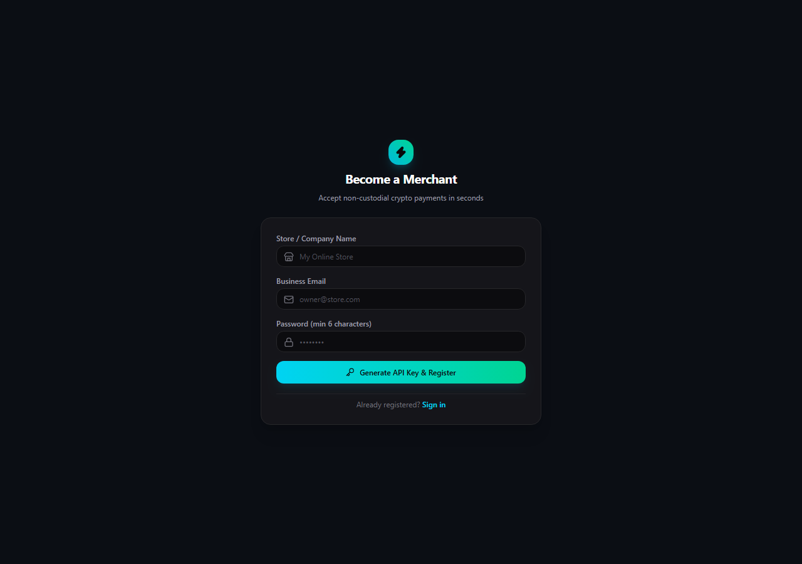
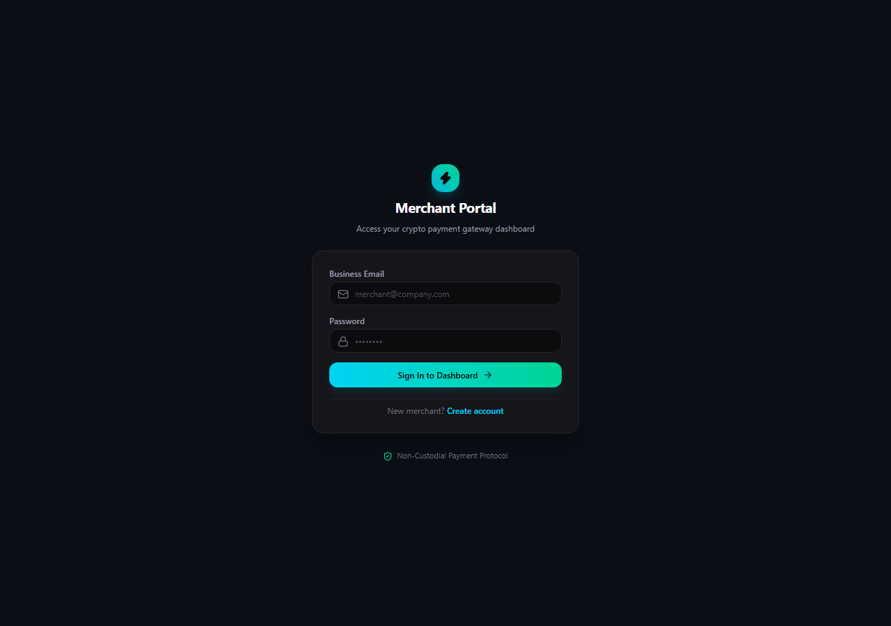
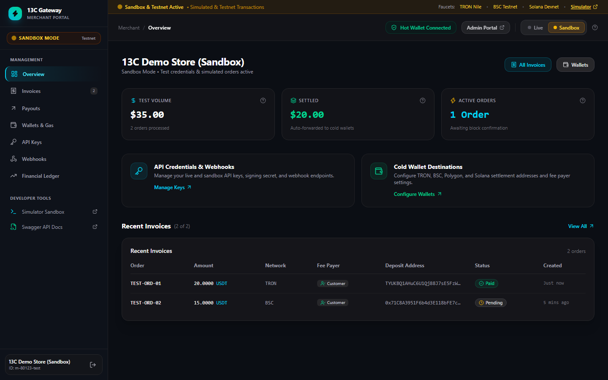
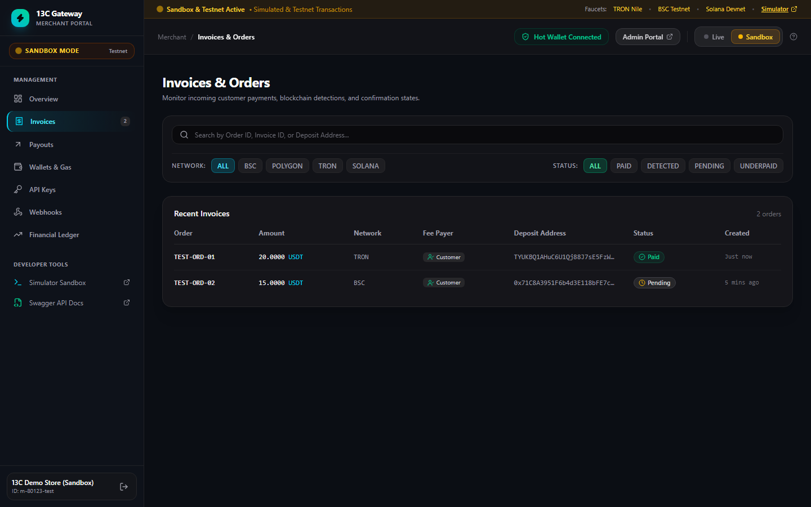
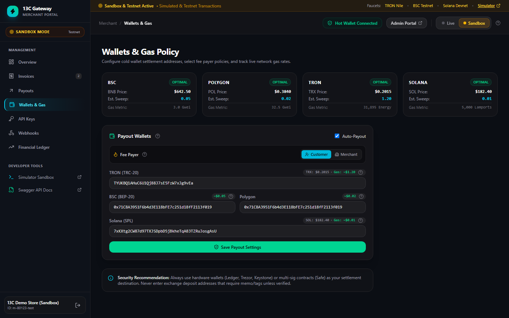
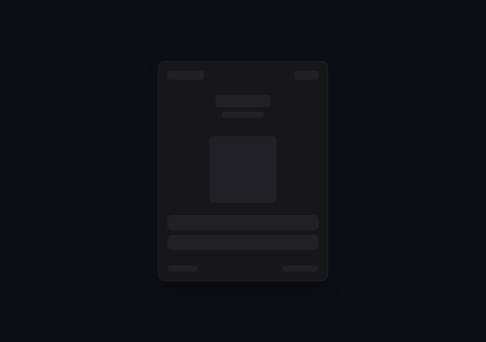
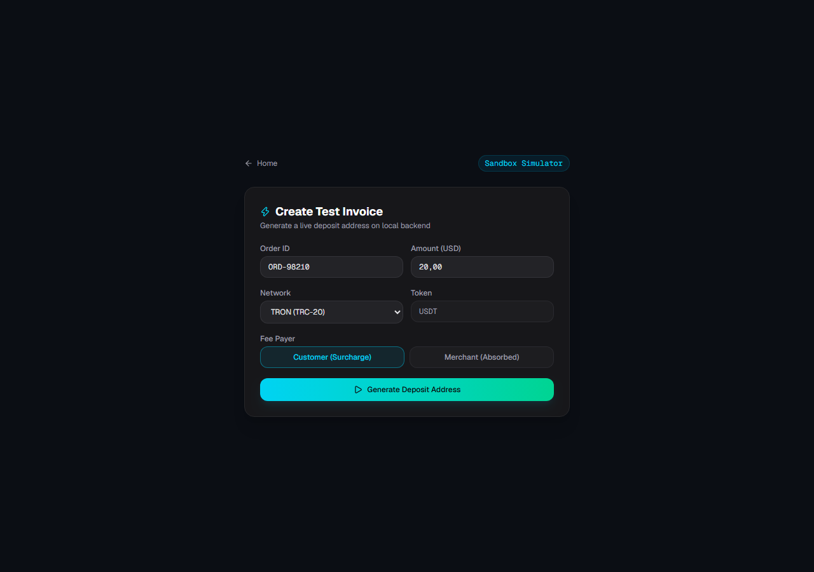
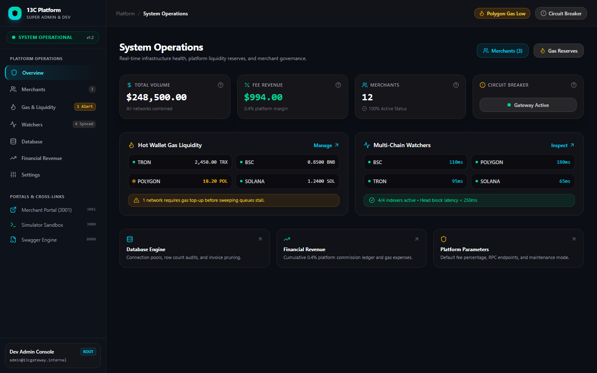
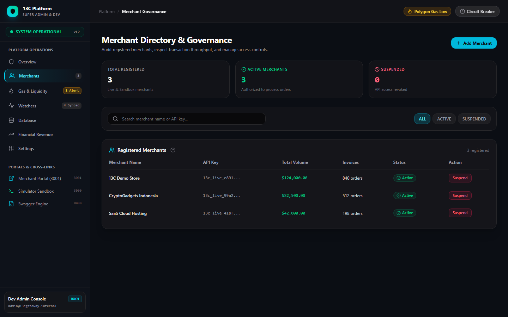
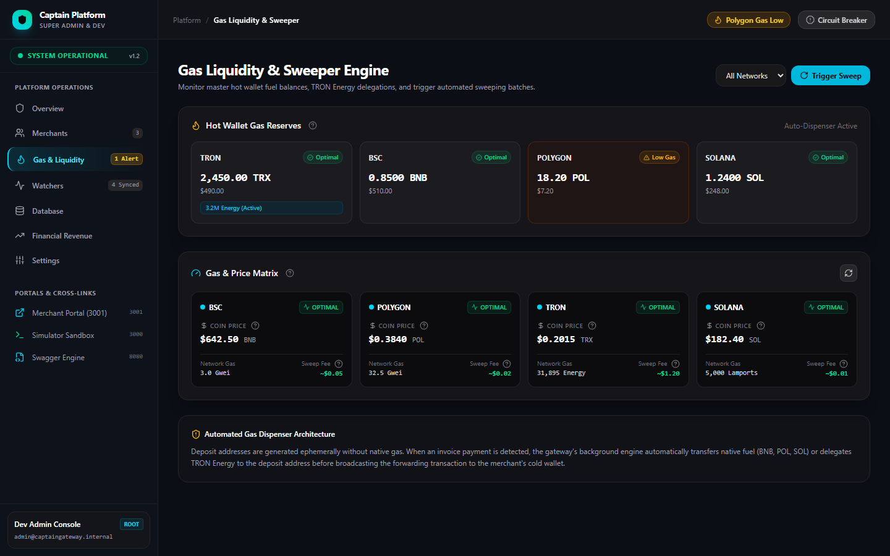

# Panduan Operasional & Dokumentasi Resmi 13C Crypto Payment Gateway

**Versi**: 1.5.0  
**Tanggal**: November 2026  
**Klasifikasi**: User Manual, Technical Specification & Integration Guide  
**Repositori**: [https://github.com/gonzhilaz/bpg.git](https://github.com/gonzhilaz/bpg.git)

---

## DAFTAR ISI

1. **Bab 1: Gambaran Umum & Spesifikasi Arsitektur**
   * 1.1 Prinsip Non-Custodial & Kedaulatan Dana
   * 1.2 Multi-Chain Network Matrix (BSC, Polygon, TRON, Solana)
   * 1.3 Siklus Tagihan 1 Invoice = 1 Dedicated Ephemeral Address
   * 1.4 Protokol Keamanan & API Key Hashing At-Rest

2. **Bab 2: Panduan Pengguna Merchant Portal**
   * 2.1 Pendaftaran Akun & Protokol *Reveal Once* API Key
   * 2.2 Autentikasi & Navigasi Dashboard
   * 2.3 Konfigurasi Cold Wallet Payout & Auto-Forwarding
   * 2.4 Pengaturan *Fee Payer* (Customer Surcharge vs. Merchant Absorbed)
   * 2.5 Pemantauan Laporan Keuangan (Financial Ledger) & Ekspor CSV
   * 2.6 Monitoring Riwayat Tagihan & Webhook Callback Logs
   * 2.7 Antarmuka Modern: Filter Dropdown Ringkas, Tema Kontras Tinggi & Dukungan Bilingual

3. **Bab 3: Tutorial Integrasi Toko Online (Merchant Integration)**
   * 3.1 Pembuatan Tagihan via REST API (cURL, Node.js, PHP, Python)
   * 3.2 Menampilkan Checkout Widget ke Pelanggan
   * 3.3 Penanganan & Validasi Tanda Tangan Kriptografis Webhook (HMAC-SHA256)

4. **Bab 4: Panduan Pengujian Sandbox & Jaringan Testnet**
   * 4.1 Menggunakan Sandbox Simulator Bawaan
   * 4.2 Pengujian Transaksi On-Chain Menggunakan Faucet Testnet Resmi

5. **Bab 5: Panduan DevOps & Super Admin Portal**
   * 5.1 Dashboard Monitoring Operasional Platform
   * 5.2 Manajemen Cadangan Gas Hot Wallet & Alert Otomatis
   * 5.3 Prosedur Penyapuan Dana Manual (*Manual Sweeper*)
   * 5.4 Pemeliharaan Database (Pool Connection & Pruning Expired Records)
   * 5.5 Emergency Circuit Breaker (Prosedur Darurat Pembekuan Payout)
   * 5.6 Deployment Mandiri di Server VPS Menggunakan Docker Compose
   * 5.7 Resolusi Dinamis Endpoint (Zero Hardcoded Localhost & Cloud Ready)

---

## BAB 1: GAMBARAN UMUM & SPESIFIKASI ARSITEKTUR

### 1.1 Prinsip Non-Custodial & Kedaulatan Dana
13C Crypto Payment Gateway dirancang untuk memecahkan kelemahan terbesar payment gateway sentralistik (seperti BitPay atau NOWPayments), yaitu risiko pembekuan dana sepihak (*fund freezing*) dan biaya perantara ganda.

Dengan arsitektur **Non-Custodial Instant Forwarding**, sistem 13C tidak pernah mengendapkan saldo merchant di akun perantara. Setiap pembayaran yang diverifikasi on-chain langsung disapu (*swept*) ke **Cold Wallet Pribadi Merchant** yang aman.

```
[Pembeli] ──────> [Alamat Tagihan Ephemeral] ──────> [Cold Wallet Merchant]
                         │
                         ▼
             [Indexer Node Memindai Event]
             [Webhook HMAC Dikirim ke Toko]
```

### 1.2 Multi-Chain Network Matrix
Sistem secara *native* mendukung 4 ekosistem blockchain utama dunia dengan biaya transaksi rendah dan finalitas blok instan:

| Blockchain | Standar Token | Satuan Biaya Gas | Kecepatan Konfirmasi | Estimasi Biaya Sweep |
| :--- | :--- | :--- | :--- | :--- |
| **BSC (BNB Smart Chain)** | BEP-20 (USDT / USDC) | Gwei (Native BNB) | ~3 Detik | ~$0.05 |
| **Polygon PoS** | ERC-20 (USDT / USDC) | Gwei (Native POL) | ~2 Detik | ~$0.02 |
| **TRON Network** | TRC-20 (USDT) | Energy & Bandwidth (TRX) | ~1 Detik | ~$1.20 |
| **Solana** | SPL Token (USDC / USDT) | Lamports (Native SOL) | ~400 Milidetik | ~$0.01 |

### 1.3 Siklus Tagihan 1 Invoice = 1 Dedicated Ephemeral Address
1. **Generasi Kunci Kriptografi**: Saat toko memanggil endpoint pembuatan invoice, backend Go membangkitkan pasangan kunci (*keypair*) baru secara dinamis menggunakan algoritma kriptografi standar industri (ECDSA secp256k1 untuk EVM/TRON dan Ed25519 untuk Solana).
2. **Enkripsi Kunci Privat**: Kunci privat dari alamat deposit langsung dienkripsi menggunakan sandi militer **AES-256-GCM** sebelum disimpan ke database.
3. **Masa Berlaku Tagihan**: Tagihan memiliki masa aktif 15–30 menit dengan hitung mundur presisi. Alamat yang kedaluwarsa tanpa pelunasan otomatis dinonaktifkan.

---

## BAB 2: PANDUAN PENGGUNA MERCHANT PORTAL

### 2.1 Pendaftaran Akun & Protokol Reveal Once API Key
Untuk menjadi merchant, kunjungi halaman registrasi di `/register`:



1. Masukkan **Nama Toko / Perusahaan**, **Business Email**, dan **Password** (minimal 6 karakter).
2. Klik tombol **Generate API Key & Register**.
3. **PENTING (Protokol Reveal Once)**: Sistem akan menampilkan kartu peringatan khusus yang memuat **Production API Key** dan **Webhook Secret**.
   * *Kunci ini hanya ditampilkan satu kali demi alasan keamanan tingkat tinggi.*
   * Segera klik tombol salin (*copy*) dan simpan di password manager atau file konfigurasi `.env` server toko Anda.
   * Di dalam database 13C Gateway, API Key disimpan dalam bentuk hash **SHA-256**, sehingga kunci asli tidak dapat dibaca oleh siapa pun jika database diretas.

### 2.2 Autentikasi & Arsitektur Multi-Route Sidebar
Kunjungi halaman login di `/login`:



1. Masukkan email bisnis dan password yang telah didaftarkan.
2. Setelah berhasil masuk, Anda akan diarahkan ke **Merchant Portal** yang dibangun dengan arsitektur enterprise modern berbasis **Persistent Sidebar** dan **Multi-Route Navigation**:



Merchant Portal dipecah menjadi beberapa rute terdedikasi:
* **`/` (Overview & KPI)**: Menampilkan metrik volume kotor, total settled, pesanan aktif, ringkasan saldo gas, dan 5 invoice terbaru.
* **`/invoices` (Invoices & Orders)**: Tabel pencarian tagihan lengkap dengan live filter pencarian, filter jaringan blockchain, dan status order.
* **`/payouts` (Payouts & Settlements)**: Riwayat transfer non-custodial ke cold wallet merchant dilengkapi tautan langsung ke explorer blockchain (BscScan, Tronscan, Polygonscan, Solscan).
* **`/wallets` (Wallets & Gas Policy)**: Konfigurasi alamat cold wallet tujuan settlement, toggle auto-payout, dan pemilih kebijakan penanggung gas (Fee Payer).
* **`/api-keys` (API Credentials)**: Kredensial API Key publik, Secret Key HMAC-SHA256, modal Reveal Once, dan cuplikan kode integrasi cURL / Node.js.
* **`/webhooks` (Webhook Logs)**: Konfigurasi callback URL, log pengiriman notifikasi HTTP POST, inspeksi status code (200 OK), dan tombol Test Ping.
* **`/reports` (Financial Ledger)**: Buku besar akuntansi pembukuan, akumulasi pendapatan bruto, potongan fee gateway (0.4%), biaya gas, dan tombol ekspor CSV.

### 2.3 Manajemen Tagihan Pelanggan (`/invoices`)
Pada halaman **Invoices & Orders**:



1. **Pencarian Real-Time**: Masukkan nomor Order ID, Invoice ID, atau Deposit Address pada kolom pencarian untuk melacak transaksi secara instan.
2. **Filter Jaringan & Status**: Gunakan chip navigasi untuk memfilter berdasarkan rantai blockchain (BSC, Polygon, TRON, Solana) dan status (`PAID`, `DETECTED`, `PENDING`, `UNDERPAID`).
3. **Tri-State Resilience**: Jika tidak ada data yang cocok, sistem menyajikan *Empty State* informatif lengkap dengan tombol **Reset All Filters**.

### 2.4 Konfigurasi Cold Wallet Payout & Gas Policy (`/wallets`)
Pada halaman **Wallets & Gas Policy**:



1. Masukkan alamat cold wallet penerima untuk masing-masing jaringan:
   * **TRON Address**: Alamat Base58 berawalan huruf `T` (misal dompet TronLink, Ledger, atau Binance).
   * **BSC Address**: Alamat 0x EVM (Trust Wallet, MetaMask, Safe).
   * **Polygon Address**: Alamat 0x EVM.
   * **Solana Address**: Alamat Base58 Solana (Phantom, Solflare).
2. Pastikan centang toggle **Auto-Payout** aktif agar dana otomatis diteruskan begitu transaksi terdeteksi.
3. **Pengaturan Fee Payer (Customer Surcharge vs. Merchant Absorbed)**:
   * **Opsi Customer (Direkomendasikan)**: Biaya gas jaringan ditambahkan ke total invoice tagihan pembeli. Pembeli membayar produk + gas surcharge, merchant menerima nominal bersih 100%.
   * **Opsi Merchant**: Pembeli membayar nominal pas harga produk, biaya gas penyapuan dipotong dari saldo yang masuk ke cold wallet merchant.
4. **Live Coin & Gas Matrix**: Pantau harga real-time koin native (BNB, POL, TRX, SOL) serta estimasi biaya transaksi sweeping terkini.

### 2.5 Pemantauan Laporan Keuangan (Financial Ledger) & Ekspor CSV
Kartu **Financial Ledger** menyediakan data audit pembukuan yang transparan:
* **Gross Sales**: Total akumulasi volume penjualan kotor.
* **Net Settled**: Total dana bersih yang telah sukses mendarat di Cold Wallet Anda.
* **Fee (0.4%)**: Akumulasi potongan biaya pemrosesan gateway.
* **Sweep Gas**: Estimasi biaya gas jaringan yang dikeluarkan untuk sweeping on-chain.
* **Filter Rentang Waktu**: Pilih `7D` (7 hari terakhir), `30D` (30 hari terakhir), atau `ALL` (sepanjang waktu).
* **Ekspor CSV**: Klik tombol **Export CSV** untuk mengunduh laporan pembukuan langsung ke komputer Anda dalam format spreadsheet.

### 2.6 Monitoring Riwayat Tagihan & Webhook Callback Logs
* **Tabel Recent Invoices**: Menampilkan nomor pesanan, nominal kripto, jaringan, deposit address, indikator Fee Payer, dan status terkini (`PENDING`, `DETECTED`, `PAID`, `UNDERPAID`, `EXPIRED`).
* **Tabel Settlement Transfers**: Menampilkan bukti tx hash on-chain dari penyapuan dana ke cold wallet Anda.
* **Kartu Webhook Delivery Logs**: Menampilkan riwayat pengiriman notifikasi HTTP POST ke server toko Anda lengkap dengan kode HTTP respons (200 OK) dan tanda tangan HMAC.

### 2.7 Antarmuka Modern: Filter Dropdown Ringkas, Tema Kontras Tinggi & Dukungan Bilingual
1. **Filter Dropdown Ringkas (Invoices & Merchants)**:
   * Menggantikan chip tombol yang memanjang secara horizontal menjadi komponen `<select>` dropdown yang padat dan hemat ruang.
   * Filter Jaringan (`All Networks`, `BSC`, `Polygon`, `TRON`, `Solana`) dan Status (`All Statuses`, `Paid`, `Detected`, `Pending`, `Underpaid`) ditempatkan sejajar dengan kolom pencarian cepat dan tombol Reset otomatis.
2. **Tema Kontras Tinggi (High-Contrast Light & Dark)**:
   * **Dark Mode (Default)**: Palet deep carbon `#0B0E14` dan slate `#12161F` dengan aksen neon cyan/emerald untuk kenyamanan visual pengembang.
   * **Light Mode**: Palet latar belakang putih bersih (`#FFFFFF` dan `#F8FAFC`) dengan kontras teks pekat `#09090B`, garis batas `#E4E4E7`, dan kartu data yang tajam tanpa silau.
   * **Tombol Pengalih**: Ikon Matahari / Bulan di bilah navigasi atas (Header) dengan penyimpanan status instan di `localStorage`.
3. **Dukungan Bilingual (English Default & Bahasa Indonesia)**:
   * Tersedia tombol selektor bahasa di Header (`EN` | `ID`).
   * Bahasa Inggris (`EN`) aktif secara default untuk standar internasional, dan dapat dialihkan ke Bahasa Indonesia (`ID`) dalam satu klik.
   * Seluruh label navigasi, status tagihan, tooltip, dan pesan sistem diterjemahkan secara komprehensif.

---

## BAB 3: TUTORIAL INTEGRASI TOKO ONLINE (MERCHANT INTEGRATION)

### 3.1 Pembuatan Tagihan via REST API
Server e-commerce toko Anda cukup memanggil endpoint berikut:

```bash
curl -X POST https://api.yourgateway.com/api/v1/invoices \
  -H "Content-Type: application/json" \
  -H "X-API-KEY: 13c_live_9a41b2c8e104f..." \
  -d '{
    "order_id": "INV-2026-001",
    "amount": 50.00,
    "currency": "USD",
    "pay_currency": "USDT",
    "pay_network": "TRON",
    "fee_payer": "customer",
    "callback_url": "https://tokosaya.com/api/crypto-webhook"
  }'
```

#### Contoh Implementasi Node.js:
```javascript
const axios = require('axios');

async function createCryptoInvoice() {
  const response = await axios.post('https://api.yourgateway.com/api/v1/invoices', {
    order_id: 'ORD-88219',
    amount: 100.00,
    currency: 'USD',
    pay_currency: 'USDT',
    pay_network: 'BSC',
    fee_payer: 'customer',
    callback_url: 'https://tokosaya.com/api/crypto-webhook'
  }, {
    headers: { 'X-API-KEY': process.env.THIRTEENC_API_KEY }
  });

  const { id, deposit_address, pay_amount, pay_currency } = response.data.data;
  console.log(`Tagihan dibuat: Kirim ${pay_amount} ${pay_currency} ke ${deposit_address}`);
  return id;
}
```

#### Contoh Implementasi PHP:
```php
<?php
$apiKey = '13c_live_9a41b2c8e104f...';
$payload = [
    'order_id'     => 'ORD-99120',
    'amount'       => 25.50,
    'currency'     => 'USD',
    'pay_currency' => 'USDT',
    'pay_network'  => 'POLYGON',
    'fee_payer'    => 'customer',
    'callback_url' => 'https://tokosaya.com/api/webhook'
];

$ch = curl_init('https://api.yourgateway.com/api/v1/invoices');
curl_setopt($ch, CURLOPT_RETURNTRANSFER, true);
curl_setopt($ch, CURLOPT_POST, true);
curl_setopt($ch, CURLOPT_POSTFIELDS, json_encode($payload));
curl_setopt($ch, CURLOPT_HTTPHEADER, [
    'Content-Type: application/json',
    'X-API-KEY: ' . $apiKey
]);

$result = json_decode(curl_exec($ch), true);
curl_close($ch);
?>
```

### 3.2 Menampilkan Checkout Widget ke Pelanggan
Setelah invoice dibuat, arahkan pembeli ke halaman checkout atau pasang iframe checkout:



Fitur Checkout Widget:
* **Dynamic QR Code**: Mendukung pemindaian dari kamera smartphone atau aplikasi Trust Wallet / Binance.
* **1-Click Copy**: Menyalin alamat deposit dan nominal presisi dalam 1 kali klik.
* **Rincian Transparan**: Menampilkan harga barang asli + surcharge gas jaringan (jika fee_payer adalah customer).
* **Hitung Mundur Kedaluwarsa**: Mencegah fluktuasi kurs yang merugikan merchant.
* **1-Click Web3 Pay**: Pembeli pengguna MetaMask atau Phantom dapat membayar langsung tanpa mengetik alamat manual.

### 3.3 Penanganan & Validasi Tanda Tangan Webhook (HMAC-SHA256)
Ketika pembayaran pembeli terkonfirmasi di blockchain, 13C Gateway mengirimkan callback HTTP POST ke `callback_url` toko Anda dengan header `X-Signature`.

#### Contoh Payload Webhook:
```json
{
  "event": "invoice.paid",
  "invoice_id": "4d374131-bcca-4749-8a5e-12c802131d1f",
  "order_id": "ORD-88219",
  "amount_paid": "100.0500",
  "pay_currency": "USDT",
  "pay_network": "BSC",
  "received_at": "2026-11-12T16:25:00Z"
}
```

#### Verifikasi Tanda Tangan di Node.js:
```javascript
const crypto = require('crypto');

function verifyWebhook(req, secretKey) {
  const signature = req.headers['x-signature'];
  const rawBody = JSON.stringify(req.body);
  const expectedSignature = 'sha256=' + crypto
    .createHmac('sha256', secretKey)
    .update(rawBody)
    .digest('hex');

  return signature === expectedSignature;
}
```

---

## BAB 4: PANDUAN PENGUJIAN SANDBOX & JARINGAN TESTNET

### 4.1 Menggunakan Sandbox Simulator Bawaan
Kunjungi `/sandbox` untuk menguji alur integrasi tanpa modal uang riil:



1. Isi form simulasi: Order ID, Nominal USD, Pilihan Network (TRON, BSC, Polygon, Solana), dan Fee Payer.
2. Klik tombol **Generate Deposit Address**.
3. Sistem akan memunculkan detail alamat uji coba dan tombol hijau **Simulate Payment**.
4. Begitu tombol simulasi diklik, backend Go akan memproses invoice seolah-olah terjadi transfer on-chain asli: status berubah menjadi `PAID`, rekonsiliasi auto-payout dibuat, dan webhook HMAC langsung ditembakkan ke URL callback toko Anda.

### 4.2 Pengujian Transaksi On-Chain Menggunakan Faucet Testnet Resmi
Jika Anda ingin menguji transaksi nyata dari dompet Web3 tanpa biaya:
1. Aktifkan jaringan Testnet pada wallet MetaMask atau Phantom Anda.
2. Klaim koin gratis melalui tautan Faucet resmi yang disediakan di banner atas Merchant Dashboard:
   * **TRON Nile Testnet**: [https://nileex.io/join/getJoinPage](https://nileex.io/join/getJoinPage)
   * **BSC Testnet Faucet**: [https://www.bnbchain.org/en/testnet-faucet](https://www.bnbchain.org/en/testnet-faucet)
   * **Solana Devnet Faucet**: [https://faucet.solana.com](https://faucet.solana.com)
3. Lakukan transfer koin testnet ke alamat deposit invoice. Watcher daemon 13C di background akan menangkap transaksi on-chain tersebut secara otomatis.

---

## BAB 5: PANDUAN DEVOPS & SUPER ADMIN PORTAL

### 5.1 Arsitektur Multi-Route Super Admin
Kunjungi Super Admin Portal di [https://bpg-admin.vercel.app](https://bpg-admin.vercel.app):



Portal ini dirancang untuk DevOps dan Operator Gateway dengan arsitektur **Persistent Sidebar** dan rute khusus:
* **`/` (System Operations)**: Ringkasan metrik kesehatan sistem, volume platform 24 jam, status gas agregat, dan saklar darurat Circuit Breaker.
* **`/merchants` (Merchant Governance)**: Direktori pendaftaran merchant, audit volume transaksi, dan aksi penangguhan (*Suspend / Activate*).
* **`/gas-liquidity` (Gas Liquidity & Sweeper Engine)**: Pemantauan saldo gas hot wallet 4 jaringan, mitigasi low gas, dan mesin pemicu penyapuan manual.
* **`/watchers` (Multi-Chain Watchers)**: Monitoring latensi RPC node, tinggi blok (*block height*), dan status pemindaian blok tanpa smart contract.
* **`/database` (Database Engine & Storage)**: Pemantauan koneksi pool PostgreSQL/SQLite, statistik baris data, dan tombol pembersihan (*prune*) invoice kedaluwarsa.
* **`/finance` (Financial Revenue Ledger)**: Audit pendapatan biaya platform 0.4%, subsidi gas, margin bersih gateway, dan ekspor CSV.
* **`/settings` (Platform Settings)**: Pengaturan persentase komisi, buffer gas transaksi, dan mode pemeliharaan (*maintenance*).

### 5.2 Tata Kelola Akun Merchant (`/merchants`)
Pada halaman **Merchant Governance**:



1. **Pencarian & Audit**: Telusuri merchant berdasarkan nama bisnis atau awalan API key.
2. **Filter Status**: Filter daftar berdasarkan merchant `ACTIVE` atau `SUSPENDED`.
3. **Aksi Kontrol**: Klik tombol **Suspend** untuk memutus otorisasi API key merchant bermasalah seketika, atau **Activate** untuk memulihkan akses.
4. **Pendaftaran Manual**: Tombol **Add Merchant** memungkinkan DevOps mendaftarkan akun merchant baru secara langsung dari konsol admin.

### 5.3 Manajemen Cadangan Gas Hot Wallet & Sweeper Engine (`/gas-liquidity`)
Pada halaman **Gas Liquidity & Sweeper Engine**:



* **Hot Wallet Balances**: Pantau saldo koin native operasional: **TRX & Energy Pool (TRON)**, **BNB (BSC)**, **POL (Polygon)**, dan **SOL (Solana)**.
* **Low Gas Alert**: Jika saldo native menipis di bawah ambang batas aman, sistem menampilkan peringatan kuning `Low Gas` di sidebar dan topbar.
* **Manual Sweeper Trigger**: Jika ada tagihan yang belum tersapu akibat gangguan jaringan, pilih jaringan pada dropdown dan klik tombol **Trigger Sweep** untuk menyapu transaksi on-chain seketika.

### 5.4 Pemeliharaan Database Tingkat Administrator (DBA Storage Suite)
Pada modul **Database Engine & Storage Maintenance**:
* **Live Connection Pool & I/O Telemetry**: Memantau kapasitas pool koneksi aktif, idle, queue, rasio *Buffer Cache Hit* (99.85%), dan latensi kueri rata-rata (1.4 ms).
* **Table Storage & Bloat Inspector**: Audit terperinci per tabel (`invoices`, `payouts`, `transactions`, `webhook_deliveries`, `audit_logs`) mencakup jumlah baris, ukuran data, ukuran indeks B-Tree, persentase *bloat / dead tuples*, dan status *auto-vacuum*.
* **Operasi VACUUM & REINDEX**: Satu klik untuk membersihkan *dead tuples*, menyusun ulang indeks terfragmentasi, dan memperbarui statistik biaya kueri PostgreSQL tanpa *table lock*.
* **Mesin Pruning dengan Dry-Run Simulation**: Pilihan retensi data (7, 14, 30, 90 hari) dengan tombol **Simulate Dry-Run** yang menghitung perkiraan baris dan ruang *disk* yang akan direklamasi sebelum eksekusi permanen dijalankan.
* **Disaster Recovery & Compressed Snapshots (`pg_dump`)**: Pembuatan *snapshot point-in-time* instan terkompresi dengan validasi *checksum* kriptografis SHA-256 dan opsi unduhan langsung.
* **Audit Migrasi SQL**: Riwayat eksekusi skrip migrasi skema lengkap dengan durasi eksekusi dalam milidetik dan status integritas skema.

### 5.5 Emergency Circuit Breaker
Pada kartu **Platform Overview**:
* Terdapat sakelar darurat **Circuit Breaker Active**.
* Jika terjadi anomali pada blockchain (misal hard fork, reorg ekstrim, atau eksploitasi RPC node eksternal), admin dapat mengaktifkan Circuit Breaker dalam 1 klik.
* Saat aktif, seluruh eksekusi payout sweeping otomatis akan dibekukan sementara di memori hingga situasi jaringan dinyatakan aman.

### 5.6 Deployment Mandiri di Server VPS Menggunakan Docker Compose
Untuk mengoperasikan backend Go dan database PostgreSQL di server VPS privat:

```bash
# 1. Kloning repositori resmi
git clone https://github.com/gonzhilaz/bpg.git
cd bpg

# 2. Sesuaikan konfigurasi rahasia pada file .env
cp .env.example .env
nano .env

# 3. Jalankan container dengan Docker Compose
docker compose up -d --build

# 4. Pantau log operasional indexer blockchain
docker compose logs -f backend
```

### 5.7 Resolusi Dinamis Endpoint (Zero Hardcoded Localhost & Cloud Ready)
Seluruh modul frontend (`dashboard`, `admin`, `demo-sandbox`) tidak lagi menggunakan URL `localhost` hardcoded. Sistem menggunakan arsitektur `getEnvUrl` yang adaptif:
* **Deteksi Lingkungan Otomatis**: Jika dijalankan di mesin lokal (`window.location.hostname === "localhost"`), sistem otomatis terhubung ke port lokal (`:8080`, `:3001`, `:3002`, `:3000`).
* **Environment Variable Terpusat**: Saat dideploy di Vercel, VPS, atau domain custom, sistem memprioritaskan variabel lingkungan publik:
  - `NEXT_PUBLIC_API_URL`: URL Backend API & Watcher Engine (contoh: `https://api.domainanda.com`).
  - `NEXT_PUBLIC_MERCHANT_URL`: URL Merchant Portal (contoh: `https://merchant.domainanda.com`).
  - `NEXT_PUBLIC_ADMIN_URL`: URL Super Admin Portal (contoh: `https://admin.domainanda.com`).
  - `NEXT_PUBLIC_SANDBOX_URL`: URL Simulator Sandbox (contoh: `https://sandbox.domainanda.com`).
  - `NEXT_PUBLIC_SWAGGER_URL`: URL Dokumentasi Interaktif Swagger API.
* **Fallback Cloud Siap Pakai**: Tanpa konfigurasi variabel sekalipun di lingkungan staging cloud, sistem menyediakan fallback default ke cluster cloud live.

---
*Dokumen manual ini dihasilkan secara otomatis dari spesifikasi arsitektur resmi 13C Crypto Payment Gateway v1.3.*


---

## BAB 6: MANAJEMEN DINAMIS RPC, KEAMANAN 2FA & ENKODING API

### 6.1 Manajemen Dinamis Multi-Chain RPC Node
Pada rute Super Admin **`/watchers`**, administrator kini memiliki kontrol penuh untuk mengelola kluster RPC multi-rantai (TRON, BSC, Polygon, Solana, atau rantai EVM kustom):
1. **Tambah Node Baru (`+ Add RPC Node`)**: Memungkinkan pendaftaran penyedia RPC cadangan (misal QuickNode Dedicated, Alchemy, Infura, atau node privat) dengan memilih jaringan, nama penyedia, dan URL endpoint HTTP/WSS.
2. **Uji Latensi Real-Time (`Test Ping`)**: Tombol ikon petir mengirim kueri blok tinggi secara langsung untuk mengukur latensi round-trip (ms).
3. **Penghapusan Node (`Delete`)**: Menghapus penyedia yang tidak stabil atau sering mengalami gangguan tanpa memutus layanan gateway.
4. **Persistensi Data**: Seluruh node kustom tersimpan secara aman dan sinkron antar-sesi pemantauan.

---

### 6.2 Autentikasi Ganda (2FA) Super Admin & Merchant Guard
Untuk mencegah akses tidak sah pada infrastruktur inti pembayaran:
* **Root Dev Admin Console**: Rute admin kini diproteksi dengan otentikasi ganda:
  - Validasi **Admin ID** internal (`admin@13cgateway.internal`).
  - **Master Secret Key** dengan batas minimum entropi.
  - **Kode 2FA TOTP (6-digit)** yang disinkronkan dengan aplikasi authenticator RFC 6238.
  - **Proteksi Anti-Brute Force**: Penguncian akun otomatis selama 60 detik jika terjadi 5 kali kegagalan input berturut-turut.
* **Merchant Dashboard Guard**: Pengguna yang belum memiliki token sesi valid (`13c_token`) akan dialihkan secara otomatis ke layar masuk (`/login`), mencegah akses langsung ke riwayat faktur atau kunci API.
* **Fitur Keluar Sesi Bersih (Sign Out)**: Tombol logout pada sidebar Admin dan Merchant membersihkan seluruh token memori dan storage seketika.

---

### 6.3 Enkoding & Proteksi Link API via Next.js BFF Reverse Proxy (Anti-Inspection)
Untuk menjawab tantangan keamanan terhadap inspeksi DevTools peramban oleh pihak luar:
1. **Penyembunyian Alamat Asli Server**: Klien tidak lagi menghubungi backend Go secara langsung pada port publik. Seluruh lalu lintas dialihkan melalui **Next.js Backend-For-Frontend (BFF)** pada rute `/api/proxy/[...path]`.
2. **Inspeksi Network DevTools Terproteksi**: Pihak luar yang membuka Network Tab peramban hanya melihat rute proksi internal relatif, bukan IP server VPS, port mikroservis, atau struktur backend internal.
3. **Header Keamanan Tambahan**: Server proksi menyematkan header anti-sniffing (`X-Content-Type-Options: nosniff`, `X-Frame-Options: DENY`, `Cache-Control: no-store`) dan memfilter metadata rentan sebelum merespons peramban.
4. **Verifikasi Tanda Tangan HMAC Kriptografis**: Walaupun peramban dapat membaca header, penyerang tidak dapat memalsukan permintaan karena setiap transaksi divalidasi dengan tanda tangan HMAC-SHA256 yang membutuhkan kunci rahasia yang tidak pernah diekspos ke publik.

---

### 6.4 Lokasi Dokumen Rahasia & Kredensial Basis Data di `/doc`
Seluruh panduan arsitektur kredensial basis data, parameter string koneksi SSL PostgreSQL, konfigurasi KMS hot wallet, dan template variabel lingkungan produksi kini didokumentasikan secara terpusat pada file:
👉 **`DOC/SECURITY_AND_CREDENTIALS.md`**
Sesuai standar keamanan industri, file rahasia asli tidak boleh di-commit secara mentah ke repositori publik dan wajib disuntikkan via Secrets Vault pada level infrastruktur VPS/Cloud.

---

### 6.5 Tata Kelola Merchant Lengkap (Full CRUD Governance & Strict Icon Buttons)
Pada portal Super Admin **`/merchants`**, tata kelola merchant kini telah ditingkatkan menjadi CRUD penuh dengan kepatuhan antarmuka modern (Zero labeled text buttons; 100% `IconButton` dengan dark `Tooltip` informatif):
* **Tambah Merchant Baru (`+ Add Merchant`)**: Tombol ikon `Plus` di header memicu modal registrasi instan untuk merchant baru.
* **Lihat Rincian (`View Details`)**: Ikon `Eye` membuka modal komprehensif menampilkan total volume, jumlah tagihan, prefix kunci API, alamat cold wallet per rantai, status auto-payout, dan URL webhook aktif.
* **Edit Merchant (`Edit Profile`)**: Ikon `Pencil` memungkinkan pembaruan nama bisnis, status operasional, penanggung biaya gas/jaringan (*Fee Payer*), dan konfigurasi webhook.
* **Rotasi Kunci API (`Rotate API Key`)**: Ikon `Key` melakukan rotasi kunci API baru secara instan disertai notifikasi reveal-once yang aman.
* **Tangguhkan / Aktifkan (`Suspend / Activate`)**: Ikon `Ban` atau `CheckCircle2` mengubah status operasional merchant dalam satu klik.
* **Hapus Merchant (`Delete Merchant`)**: Ikon `Trash2` menghapus merchant dari direktori disertai modal konfirmasi pengamanan.

---

### 6.6 Kluster RPC Dinamis Terintegrasi EXP & Switcher Testnet Sandbox
Untuk mendukung pengujian testnet sandbox tanpa batas dan toleransi kesalahan (*fault-tolerance*):
* **Penyedia RPC Terintegrasi**: Mengintegrasikan node-node cadangan dari jaringan EXP (`https://exp-api-jet.vercel.app/`):
  - **TRON**: TronGrid Official, Tron PublicNode, dan Nile Testnet.
  - **BSC**: Binance Official, LlamaRPC, dan Chapel Testnet.
  - **Polygon**: Polygon PoS Official, LlamaRPC, dan Amoy Testnet.
  - **Solana**: Solana Mainnet-Beta dan Solana Devnet.
  - **Ethereum**: Cloudflare ETH dan Sepolia Testnet.
* **Filter Segmentasi Mainnet vs. Testnet**: Memudahkan administrator beralih antara melihat semua node, node produksi, atau node pengujian sandbox.
* **Proteksi Anti-Replay Serangan Konkuren (Backend Go)**: Validasi ketat `tx_hash` unik pada tabel pembayaran mencegah pencatatan ganda (*double-crediting*) saat pemindaian ulang blok blockchain terjadi.
* **Proteksi Rute Backend Admin**: Middleware `AdminAuth` mengunci seluruh endpoint `/api/v1/admin/*` dengan verifikasi `X-Admin-Key` dan token sesi master.

---
*Dokumen manual ini diperbarui secara resmi untuk 13C Crypto Payment Gateway v1.5 Enterprise Edition.*
