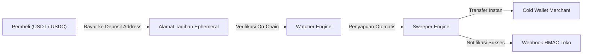

# Panduan Operasional & Dokumentasi Resmi 13C Crypto Payment Gateway

**Versi**: 2.3.0 (Enterprise Edition)  
**Tanggal**: November 2026  
**Klasifikasi**: User Manual & Operational Testing Guide  
**Repositori**: [https://github.com/gonzhilaz/bpg.git](https://github.com/gonzhilaz/bpg.git)

---

## DAFTAR ISI LENGKAP

1. **Bab 1: Gambaran Umum & Spesifikasi Arsitektur Non-Custodial**
   * 1.1 Prinsip Non-Custodial & Kedaulatan Dana
   * 1.2 Multi-Chain Network Matrix (BSC, Polygon, TRON, Solana)
   * 1.3 Siklus Tagihan 1 Invoice = 1 Dedicated Ephemeral Address
   * 1.4 Protokol Keamanan & API Key Hashing At-Rest

2. **Bab 2: Persiapan & Prasyarat Pengujian Sistem (Testing Setup Guide)**
   * 2.1 Prasyarat Lingkungan Perangkat Lunak (Software Prerequisites)
   * 2.2 Konfigurasi Berkas Lingkungan (.env, .env.local)
   * 2.3 Persiapan Dompet Kripto & Saldo Faucet Testnet
   * 2.4 Pendanaan Saldo Gas Hot Wallet Platform
   * 2.5 Prosedur Menjalankan Layanan (Backend, Dashboard & Demo Store)
   * 2.6 Panduan Pengujian Transaksi End-to-End (E2E Walkthrough)

3. **Bab 3: Panduan Pengguna Merchant Portal & Keterangan UI**
   * 3.1 Pendaftaran Akun & Protokol Reveal Once API Key
   * 3.2 Autentikasi, Multi-Route Sidebar & Navigasi
   * 3.3 Manajemen Tagihan Pelanggan (`/invoices`) & Filter Dropdown
   * 3.4 Konfigurasi Cold Wallet Payout & Gas Policy (`/wallets`)
   * 3.5 Pemantauan Laporan Keuangan (Financial Ledger) & Ekspor CSV
   * 3.6 Log Webhook & Tombol Test Ping / Manual Replay
   * 3.7 Manajemen Multi-Toko (Multi-Store per Merchant)

4. **Bab 4: Tutorial Integrasi Toko Online (Merchant Integration)**
   * 4.1 Pembuatan Tagihan via REST API (cURL, Node.js, PHP, Python)
   * 4.2 Menampilkan Checkout Widget ke Pelanggan
   * 4.3 Penanganan & Validasi Tanda Tangan Kriptografis Webhook (HMAC-SHA256)
   * 4.4 Plugin Resmi WooCommerce WordPress (`plugins/woocommerce-13c-gateway`)

5. **Bab 5: Pengujian Transaksi di Lingkungan Sandbox & Edge Cases**
   * 5.1 Menggunakan Sandbox Simulator Bawaan
   * 5.2 Pengujian Transaksi On-Chain Menggunakan Faucet Testnet Resmi
   * 5.3 Simulasi Edge Cases (Underpaid, Overpaid, Expired)

6. **Bab 6: Operasional DevOps & Konsol Super Admin**
   * 6.1 Dashboard Monitoring Operasional Platform
   * 6.2 Manajemen Cadangan Gas Hot Wallet & Alert Otomatis
   * 6.3 Prosedur Penyapuan Dana Manual (Manual Sweeper)
   * 6.4 Pemeliharaan Database (Pool Connection & Pruning Expired Records)
   * 6.5 Emergency Circuit Breaker (Prosedur Darurat Pembekuan Payout)
   * 6.6 Deployment Mandiri di Server VPS Menggunakan Docker Compose
   * 6.7 Resolusi Dinamis Endpoint (Zero Hardcoded Localhost & Cloud Ready)

7. **Bab 7: Manajemen Dinamis RPC, Keamanan 2FA & Next.js BFF Proxy**
   * 7.1 Manajemen Dinamis Multi-Chain RPC Node
   * 7.2 Autentikasi Ganda (2FA) Super Admin & Merchant Guard
   * 7.3 Enkoding & Proteksi Link API via Next.js BFF Reverse Proxy
   * 7.4 Tata Kelola Merchant Lengkap (Full CRUD Governance & Action Buttons)

8. **Bab 8: Sistem Escrow, Buku Besar Saldo Internal & Workflow Withdrawal**
   * 8.1 Arsitektur Hybrid: Non-Custodial Instant Forward vs. Escrow Balance
   * 8.2 Permintaan Penarikan Dana (Merchant Withdrawal)
   * 8.3 Tata Kelola Persetujuan Super Admin (Approve & Broadcast vs. Reject & Refund)

9. **Bab 9: Fitur Tingkat Tinggi & Optimisasi Industri**
   * 9.1 Real-Time Server-Sent Events (SSE) pada Checkout Widget
   * 9.2 Efisiensi Gas Biaya Sweeping via TRON Energy Rental
   * 9.3 Indeks Komposit Database & Automated Pruner Worker

10. **Bab 10: Panduan Pemecahan Masalah Komprehensif (Troubleshooting & FAQs)**
    * 10.1 Transaksi Kurang Bayar (Underpaid Invoice) & Ambang Batas Toleransi
    * 10.2 Tagihan Kedaluwarsa (Expired Invoice) Saat Dana Baru Dikirim
    * 10.3 RPC Node Timeout / Rate Limit (HTTP 429) & Failover Otomatis
    * 10.4 Kegagalan Pengiriman Webhook & Prosedur Manual Replay
    * 10.5 Saldo Gas Hot Wallet Menipis & Peringatan Ambang Batas
    * 10.6 Penanganan SQLite Lock (`database is locked`) & WAL Tuning

---

## BAB 1: GAMBARAN UMUM & SPESIFIKASI ARSITEKTUR

### 1.1 Prinsip Non-Custodial & Kedaulatan Dana
13C Crypto Payment Gateway dirancang untuk memecahkan kelemahan terbesar payment gateway sentralistik konvensional, yaitu risiko pembekuan dana sepihak (*fund freezing*) dan biaya perantara ganda.

Dengan arsitektur **Non-Custodial Instant Forwarding**, sistem 13C tidak pernah mengendapkan saldo merchant di akun perantara. Setiap pembayaran yang diverifikasi on-chain langsung disapu (*swept*) ke **Cold Wallet Pribadi Merchant** yang aman.



### 1.2 Multi-Chain Network Matrix
Sistem mendukung 4 jaringan blockchain terpopuler di dunia secara simultan:

| Blockchain | Standar Token | Satuan Gas | Kecepatan Finalitas | Karakteristik Utama |
| :--- | :--- | :--- | :--- | :--- |
| **BNB Smart Chain (BSC)** | BEP-20 (USDT/USDC) | BNB | 3 detik (3 blok) | Biaya gas sangat murah, ekosistem likuiditas tinggi |
| **Polygon (PoS)** | ERC-20 (USDT/USDC) | POL / MATIC | 2.1 detik (15 blok) | Kompatibel EVM, throughput tinggi |
| **TRON** | TRC-20 (USDT) | TRX / Energy | ~3 detik (19 blok) | Standar industri transfer USDT global |
| **Solana** | SPL Token (USDT/USDC) | SOL | 400 ms (Confirmed slot) | Kecepatan ultra-tinggi, finalitas instan |

### 1.3 Siklus Tagihan: 1 Invoice = 1 Dedicated Ephemeral Address
Untuk menjamin privasi dan kemudahan audit pembukuan:
* Setiap pembuatan invoice menghasilkan pasangan kunci unik baru (*fresh keypair*).
* Alamat deposit ini bertindak sebagai penampung sementara hanya untuk 1 transaksi spesifik tersebut.
* Tidak diperlukan Memo atau Tag tambahan dari pembeli, sehingga meminimalisasi salah transfer oleh pembeli awam.
* Kunci privat dienkripsi dengan **AES-256-GCM** sebelum disimpan ke database, dan dihapus dari memori aktif setelah penyapuan selesai.


---

## BAB 2: PERSIAPAN & PRASYARAT PENGUJIAN SISTEM

Sebelum memulai pengujian fungsional dan operasional 13C Crypto Payment Gateway, pastikan lingkungan pengujian telah dipersiapkan sesuai dengan petunjuk teknis berikut.

### 2.1 Prasyarat Lingkungan Perangkat Lunak (Software Prerequisites)
Pastikan komputer atau server pengujian telah terpasang perangkat lunak berikut:
1. **Go (Golang) v1.22 atau lebih baru:** Diperlukan untuk mengompilasi dan menjalankan backend engine (`go version`).
2. **Node.js v18.x atau v20.x (LTS) & npm:** Diperlukan untuk antarmuka Merchant Dashboard dan Demo Sandbox Store (`node -v && npm -v`).
3. **SQLite3:** Basis data bawaan yang tertanam otomatis tanpa konfigurasi server DBMS terpisah.
4. **Web Browser & Dompet Kripto (Non-Custodial Wallet):**
   * **Ekstensi Browser Desktop:** MetaMask (untuk BSC & Polygon), TronLink (untuk TRON), dan Phantom (untuk Solana).
   * **Aplikasi Seluler (Opsional):** Trust Wallet, Bitget Wallet, atau TokenPocket untuk menguji pemindaian QR code pada checkout widget.

### 2.2 Konfigurasi Berkas Lingkungan (.env)
Sistem menggunakan berkas konfigurasi lingkungan di masing-masing modul:

#### A. Konfigurasi Backend (`backend/.env`)
Salin berkas contoh atau buat berkas `.env` di dalam folder `backend/`:
```ini
PORT=8080
DATABASE_URL=data/gateway.db
MASTER_SECRET_KEY=0123456789abcdef0123456789abcdef0123456789abcdef0123456789abcdef
JWT_SECRET=super-secret-jwt-key-for-local-testing-13c

# Node RPC Jaringan Testnet
BSC_RPC_URL=https://data-seed-prebsc-1-s1.binance.org:8545/
POLYGON_RPC_URL=https://rpc-amoy.polygon.technology/
TRON_RPC_URL=https://api.shasta.trongrid.io
SOLANA_RPC_URL=https://api.devnet.solana.com

# Kunci Privat Hot Wallet Pengirim Gas (Penyapuan Otomatis)
EVM_HOT_WALLET_KEY=your_testnet_evm_private_key_without_0x
TRON_HOT_WALLET_KEY=your_testnet_tron_private_key
SOLANA_HOT_WALLET_KEY=your_testnet_solana_private_key_base58
```

#### B. Konfigurasi Merchant Dashboard (`dashboard/.env.local`)
Buat berkas `.env.local` di folder `dashboard/`:
```ini
NEXT_PUBLIC_API_URL=http://localhost:8080
```

#### C. Konfigurasi Demo Sandbox Store (`demo-sandbox/.env.local`)
Buat berkas `.env.local` di folder `demo-sandbox/`:
```ini
NEXT_PUBLIC_GATEWAY_URL=http://localhost:8080
```

### 2.3 Persiapan Dompet Kripto & Saldo Faucet Testnet
Untuk melakukan transaksi on-chain nyata di jaringan uji coba (*Testnet*):
* **BSC Testnet:**
  * Tambahkan RPC BSC Testnet ke MetaMask (Chain ID: `97`, Simbol: `tBNB`).
  * Ambil saldo gas gratis di Faucet resmi: `https://testnet.binance.org/faucet-smart`.
* **Polygon Amoy Testnet:**
  * Tambahkan jaringan Polygon Amoy (Chain ID: `80002`, Simbol: `POL`).
  * Ambil saldo gas di Faucet resmi: `https://faucet.polygon.technology/`.
* **TRON Shasta Testnet:**
  * Beralih ke jaringan Shasta pada dompet TronLink.
  * Minta saldo TRX testnet gratis di: `https://www.trongrid.io/shasta`.
* **Solana Devnet:**
  * Ubah pengaturan jaringan dompet Phantom ke **Devnet**.
  * Dapatkan SOL devnet melalui terminal (`solana airdrop 2`) atau situs faucet: `https://faucet.solana.com/`.

### 2.4 Pendanaan Saldo Gas Hot Wallet Platform
* Karena 13C bekerja secara non-custodial dengan penyapuan otomatis (*instant auto-sweep*), alamat dompet Hot Wallet platform wajib diisi saldo koin native secukupnya (misal: 0.02 tBNB, 2 POL, 30 Shasta TRX, 0.2 devnet SOL).
* Saldo ini berfungsi untuk membayar ongkos transaksi (*gas fee*) saat sistem memindahkan USDT dari alamat invoice ke dompet merchant.

### 2.5 Prosedur Menjalankan Layanan Pengujian
Jalankan 3 terminal PowerShell terpisah pada direktori proyek:

```powershell
# Terminal 1: Backend API Engine (Port 8080)
cd backend
go run cmd/server/main.go

# Terminal 2: Merchant Dashboard (Port 3000)
cd dashboard
npm install
npm run dev

# Terminal 3: Demo Sandbox Store (Port 3001)
cd demo-sandbox
npm install
npm run dev -- -p 3001
```

### 2.6 Panduan Pengujian Transaksi End-to-End (E2E Walkthrough)
1. **Buka Merchant Portal:** Akses `http://localhost:3000/register` dan daftarkan akun merchant baru.
2. **Amankan Kredensial:** Simpan `API Key` dan `Webhook Secret` yang ditampilkan dalam modal *Reveal Once*.
3. **Konfigurasi Dompet Penampung:** Buka menu **Wallets**, lalu masukkan alamat Cold Wallet pribadi Anda untuk menerima dana.
4. **Simulasi Transaksi Toko:**
   * Buka Demo Store di `http://localhost:3001`.
   * Pilih barang, klik **Checkout with 13C Crypto**, lalu pilih jaringan pembayaran (contoh: BSC Testnet).
   * Transfer nominal kripto yang tertera ke alamat deposit QR yang muncul di layar.
5. **Verifikasi Otomatis:**
   * Halaman checkout secara real-time beralih status: `PENDING` $\to$ `DETECTED` $\to$ `PAID`.
   * Periksa dompet Cold Wallet Anda: Saldo USDT telah masuk secara instan via Auto-Sweeper.
   * Periksa menu **Webhooks** di dashboard untuk melihat log pengiriman notifikasi sukses bertanda tangan HMAC.
6. **Alternatif Cepat (Mock Simulator):** Jika tidak memiliki saldo testnet on-chain, gunakan menu **Sandbox Simulator** di `http://localhost:3000/sandbox` untuk menguji alur secara instan tanpa menunggu konfirmasi blok blockchain.


---

## BAB 3: PANDUAN PENGGUNA MERCHANT PORTAL & KETERANGAN UI

### 3.1 Pendaftaran Akun & Protokol Reveal Once API Key
1. **Pendaftaran:** Akses rute `/register` pada browser. Masukkan Nama Usaha, Email aktif, dan Password aman (minimal 8 karakter).
2. **Kartu Kredensial (Reveal Once):**
   * Begitu pendaftaran sukses, sistem menampilkan modal dialog khusus yang memuat **API Key** dan **Webhook Secret**.
   * **PENTING:** Kunci mentah (*raw plaintext*) ini hanya ditampilkan **SATU KALI SAJA**. Sistem hanya menyimpan versi *SHA-256 hash* di database.
   * Merchant wajib menekan tombol **Salin Kunci** dan menyimpannya di tempat yang aman (misalnya *password manager* atau berkas `.env` toko online).
3. **Regenerasi Kunci Darurat:** Jika API Key hilang atau bocor, merchant dapat membuka menu **Settings** dan menekan tombol **Regenerate API Key**. Seluruh kunci lama seketika tidak berlaku.

### 3.2 Autentikasi, Multi-Route Sidebar & Navigasi
Portal Merchant dirancang dengan layout modern berbasis Next.js App Router dengan *persistent left sidebar*:
* **Dashboard Overview (`/`):** Menampilkan ringkasan volume bruto, jumlah transaksi sukses, grafik tren 7 hari, dan status konektivitas basis data.
* **Invoices (`/invoices`):** Daftar lengkap tagihan pembayaran pelanggan.
* **Wallets & Gas (`/wallets`):** Pengaturan alamat cold wallet penampung dana per jaringan.
* **Financial Ledger (`/ledger`):** Buku besar pembukuan akuntansi dana masuk dan biaya jaringan.
* **Webhooks (`/webhooks`):** Pengaturan endpoint notifikasi dan log audit pengiriman callback.
* **Sandbox Simulator (`/sandbox`):** Laboratorium simulasi transaksi tanpa biaya.
* **Tombol Logout:** Berada di sudut kiri bawah untuk memutus sesi JWT dan menghapus token dari memori lokal.

### 3.3 Manajemen Tagihan Pelanggan (`/invoices`)
Halaman ini menampilkan tabel seluruh transaksi yang diterbitkan toko:
* **Komponen Filter Dropdown:**
  * **Filter Status:** Menyaring invoice berdasarkan status `ALL`, `PENDING`, `DETECTED`, `PAID`, `UNDERPAID`, `EXPIRED`.
  * **Filter Jaringan:** Menyaring berdasarkan chain (`BSC`, `POLYGON`, `TRON`, `SOLANA`).
* **Fitur Live Search:** Pencarian instan berdasarkan Order ID toko atau Deposit Address.
* **Tindakan Baris:** Menekan baris tagihan akan membuka detail invoice, hash transaksi on-chain di blockchain explorer, dan payload webhook terkait.

### 3.4 Konfigurasi Cold Wallet Payout & Gas Policy (`/wallets`)
Pada menu ini, merchant menentukan ke mana dana USDT/USDC akan diteruskan secara instan:
1. **Pengaturan Alamat Payout:**
   * **EVM Payout Address (BSC & Polygon):** Wajib alamat hex 42 karakter (`0x...`).
   * **TRON Payout Address:** Wajib alamat Base58 diawali huruf `T` (34 karakter).
   * **Solana Payout Address:** Wajib alamat Base58 publik Solana (32-44 karakter).
2. **Kebijakan Pembebanan Biaya Gas (Gas Policy):**
   * **Customer Surcharge:** Biaya gas sweeping ditambahkan ke nominal bayar pembeli. Merchant menerima dana bersih utuh sesuai harga barang.
   * **Merchant Absorbed:** Pembeli membayar tepat sesuai harga barang. Biaya gas penyapuan dipotong dari saldo akhir yang mendarat di dompet merchant.

### 3.5 Pemantauan Laporan Keuangan (Financial Ledger) & Ekspor CSV
Menu `/ledger` mencatat pergerakan akuntansi secara detail:
* **Gross Inflow:** Total nominal yang dibayarkan pelanggan di blockchain.
* **Gas Network Fee:** Biaya riil jaringan yang dikeluarkan Hot Wallet untuk proses sweeping.
* **Platform Fee:** Biaya jasa gateway (jika dikonfigurasi oleh Super Admin).
* **Net Settled:** Nominal bersih yang diterima pada Cold Wallet pribadi merchant.
* **Tombol Export CSV:** Mengunduh seluruh riwayat pembukuan dalam format spreadsheet CSV untuk rekonsiliasi keuangan bulanan.

### 3.6 Log Webhook & Tombol Test Ping / Manual Replay
Menu `/webhooks` memberikan kendali penuh terhadap integrasi callback:
* **Webhook URL:** Masukkan alamat URL backend toko Anda (misal: `https://tokosaya.com/api/payment-callback`).
* **Tombol Test Ping:** Mengirimkan sampel payload dummy bertanda tangan HMAC-SHA256 untuk memverifikasi apakah server toko merchant merespons dengan HTTP status 200 OK.
* **Tabel Log Callback:** Menampilkan riwayat percobaan pengiriman, response code dari server merchant, durasi latensi, serta payload yang dikirim.
* **Tombol Resend / Replay:** Jika server toko merchant sempat mengalami *downtime*, merchant dapat menekan tombol **Replay** untuk mengirim ulang webhook transaksi tersebut.

### 3.7 Manajemen Multi-Toko (Multi-Store per Merchant)
Bagi merchant yang memiliki beberapa cabang bisnis atau unit usaha terpisah:
* Merchant dapat membuat entitas **Store** baru di bawah satu akun organisasi login.
* Setiap toko memiliki nama unik, URL webhook tersendiri, dan alamat Cold Wallet terpisah.
* Beralih antar toko dilakukan melalui *Store Switcher* pada bagian atas sidebar tanpa perlu keluar-masuk akun.


---

## BAB 4: TUTORIAL INTEGRASI TOKO ONLINE (MERCHANT INTEGRATION)

### 4.1 Pembuatan Tagihan via REST API
Untuk menerbitkan invoice kripto dari server backend toko online Anda, kirimkan permintaan HTTP `POST` ke endpoint `/api/v1/invoices` dengan menyertakan header otentikasi `X-API-KEY`.

#### Spesifikasi Endpoint:
* **Method:** `POST`
* **URL:** `http://localhost:8080/api/v1/invoices` (atau domain produksi gateway Anda)
* **Headers:**
  * `Content-Type: application/json`
  * `X-API-KEY: <API_KEY_MERCHANT_ANDA>`

#### Contoh Payload Request (JSON):
```json
{
  "order_id": "ORDER-20261121-001",
  "amount": 25.50,
  "currency": "USDT",
  "pay_network": "BSC",
  "fee_payer": "customer",
  "customer_email": "buyer@example.com"
}
```

#### Contoh Implementasi Multi-Bahasa:

##### A. Menggunakan cURL (Command Line / Bash)
```bash
curl -X POST http://localhost:8080/api/v1/invoices \
  -H "Content-Type: application/json" \
  -H "X-API-KEY: 13c_live_samplekey1234567890abcdef" \
  -d '{
    "order_id": "INV-1001",
    "amount": 10.00,
    "currency": "USDT",
    "pay_network": "TRON",
    "fee_payer": "customer"
  }'
```

##### B. Menggunakan Node.js / JavaScript (Fetch API)
```javascript
const response = await fetch("http://localhost:8080/api/v1/invoices", {
  method: "POST",
  headers: {
    "Content-Type": "application/json",
    "X-API-KEY": process.env.PAYMENT_GATEWAY_API_KEY
  },
  body: JSON.stringify({
    order_id: "ORD-9901",
    amount: 50.00,
    currency: "USDT",
    pay_network: "POLYGON",
    fee_payer: "merchant"
  })
});

const data = await response.json();
console.log("Deposit Address:", data.deposit_address);
console.log("Checkout URL:", data.checkout_url);
```

##### C. Menggunakan PHP (cURL Native)
```php
<?php
$ch = curl_init('http://localhost:8080/api/v1/invoices');
$payload = json_encode([
    'order_id'    => 'ORD-PHP-8812',
    'amount'      => 15.00,
    'currency'    => 'USDT',
    'pay_network' => 'BSC',
    'fee_payer'   => 'customer'
]);

curl_setopt($ch, CURLOPT_POSTFIELDS, $payload);
curl_setopt($ch, CURLOPT_HTTPHEADER, [
    'Content-Type: application/json',
    'X-API-KEY: ' . getenv('13C_API_KEY')
]);
curl_setopt($ch, CURLOPT_RETURNTRANSFER, true);
$result = curl_exec($ch);
curl_close($ch);

$invoice = json_decode($result, true);
header('Location: ' . $invoice['checkout_url']);
exit;
```

##### D. Menggunakan Python (Requests)
```python
import os, requests

url = "http://localhost:8080/api/v1/invoices"
headers = {
    "Content-Type": "application/json",
    "X-API-KEY": os.getenv("C13_API_KEY")
}
payload = {
    "order_id": "PY-ORDER-502",
    "amount": 100.0,
    "currency": "USDT",
    "pay_network": "SOLANA",
    "fee_payer": "customer"
}

resp = requests.post(url, json=payload, headers=headers)
print(resp.json())
```

### 4.2 Menampilkan Checkout Widget ke Pelanggan
Toko online memiliki 3 pilihan fleksibel dalam menampilkan antarmuka pembayaran:
1. **Direct Redirect:** Mengarahkan pembeli langsung ke URL yang dikembalikan API (`data.checkout_url`).
2. **Embedded iFrame:** Menyematkan tampilan checkout di dalam kontainer halaman toko:
   ```html
   <iframe src="http://localhost:8080/checkout?invoice=INV-UUID" width="100%" height="650px" frameborder="0"></iframe>
   ```
3. **Modal Overlay:** Membuka widget sebagai *pop-up dialog* di atas halaman keranjang belanja menggunakan JavaScript SDK.

### 4.3 Penanganan & Validasi Webhook (HMAC-SHA256)
Setiap kali status pembayaran berubah (`PAID`, `UNDERPAID`, `EXPIRED`), backend 13C mengirimkan notifikasi HTTP `POST` ke Webhook URL toko Anda.
Untuk memastikan payload benar-benar berasal dari sistem 13C dan belum diubah di tengah jalan, sistem menyematkan tanda tangan kriptografis pada header HTTP: `X-13C-Signature`.

#### Contoh Verifikasi Tanda Tangan Webhook di Node.js:
```javascript
const crypto = require("crypto");

app.post("/api/payment-callback", (req, res) => {
  const signature = req.headers["x-13c-signature"];
  const rawBody = JSON.stringify(req.body);
  const webhookSecret = process.env.PAYMENT_GATEWAY_WEBHOOK_SECRET;

  const expectedSignature = crypto
    .createHmac("sha256", webhookSecret)
    .update(rawBody)
    .digest("hex");

  if (signature !== expectedSignature) {
    return res.status(401).send("Invalid Webhook Signature!");
  }

  const { event, order_id, amount, status, tx_hash } = req.body;
  if (status === "PAID") {
    // Update status pesanan di database toko Anda menjadi 'Sudah Dibayar'
    markOrderAsPaid(order_id, tx_hash);
  }

  // Wajib kembalikan HTTP 200 OK agar gateway tidak mengulang pengiriman
  res.status(200).json({ received: true });
});
```

### 4.4 Plugin Resmi WooCommerce WordPress
Bagi toko online yang menggunakan platform WordPress WooCommerce:
1. Salin folder plugin `plugins/woocommerce-13c-gateway` ke direktori `wp-content/plugins/` di server WordPress Anda.
2. Buka **WP Admin -> Plugins -> Installed Plugins**, lalu klik **Activate** pada *13C Crypto Gateway for WooCommerce*.
3. Buka **WooCommerce -> Settings -> Payments -> 13C Crypto Gateway**.
4. Masukkan **Gateway API URL**, **API Key**, dan **Webhook Secret**.
5. Simpan pengaturan. Metode pembayaran kripto multi-chain kini aktif di halaman *checkout* WooCommerce Anda.


---

## BAB 5: PENGUJIAN TRANSAKSI DI LINGKUNGAN SANDBOX & EDGE CASES

### 5.1 Menggunakan Sandbox Simulator Bawaan
Untuk memfasilitasi pengujian cepat oleh tim pengembang toko tanpa harus menunggu konfirmasi blok blockchain atau mengeluarkan koin gas nyata:
1. Akses menu **Sandbox Simulator** (`/sandbox`) pada Merchant Portal.
2. Masukkan parameter tagihan (Order ID, Nominal, dan Jaringan yang diinginkan).
3. Klik tombol **Buat Tagihan Uji Coba**.
4. Sistem akan menampilkan tombol simulasi interaktif:
   * **Simulate Full Payment (100%):** Memalsukan deposit saldo penuh, memicu watcher, sweeper, dan pengiriman webhook sukses `INVOICE_PAID`.
   * **Simulate Underpayment (Kurang Bayar):** Menyetor nominal di bawah tagihan (misal $8 dari tagihan $10) untuk menguji respon toko terhadap event `INVOICE_UNDERPAID`.
   * **Simulate Expiry (Kedaluwarsa):** Mempercepat waktu invoice hingga kedaluwarsa untuk menguji event `INVOICE_EXPIRED`.

### 5.2 Pengujian Transaksi On-Chain Nyata (Testnet Faucets)
Jika ingin menguji aliran blockchain sesungguhnya dari dompet non-custodial:
1. Pastikan Anda memiliki saldo testnet (tBNB di BSC Testnet, POL di Polygon Amoy, Shasta TRX di TRON, atau devnet SOL di Solana).
2. Buat invoice melalui Demo Store (`http://localhost:3001`) atau via REST API.
3. Buka dompet MetaMask / TronLink / Phantom Anda, lalu kirimkan token USDT testnet ke alamat deposit ephemeral yang tertera pada invoice.
4. Perhatikan terminal backend:
   * Dalam hitungan detik, Watcher mencatat log: `[WATCHER] Detected deposit of X USDT on chain Y`.
   * Setelah konfirmasi kedalaman blok terpenuhi, status berubah menjadi `PAID`.
   * Auto-sweeper langsung mengeksekusi transfer dari alamat deposit ke dompet Payout merchant Anda.

---

## BAB 6: OPERASIONAL DEVOPS & KONSOL SUPER ADMIN

### 6.1 Dashboard Monitoring Operasional Platform
Konsol Super Admin (`/admin`) menyediakan visibilitas menyeluruh terhadap kesehatan platform:
* **Total Volume & Transaksi:** Agregasi volume kumulatif dari seluruh merchant.
* **Cadangan Gas Platform:** Indikator visual saldo native Hot Wallet (BNB, POL, TRX, SOL) secara real-time.
* **Status Worker Background:** Indikator kondisi aktif daemon Watcher, Sweeper, dan Webhook Dispatcher.

### 6.2 Manajemen Cadangan Gas Hot Wallet & Alert Otomatis
Platform memerlukan koin native pada dompet Hot Wallet penampung untuk mendanai gas fee saat melakukan sweeping USDT/USDC ke Cold Wallet merchant:
* **Ambang Batas Peringatan (Low Gas Alert):** Jika saldo koin native berada di bawah ambang batas aman (misal < 0.01 BNB, < 1 POL, < 20 TRX, < 0.05 SOL), sistem memicu indikator peringatan berwarna merah pada dashboard.
* **Prosedur Top-Up:** Super Admin cukup mentransfer koin native tambahan ke alamat Hot Wallet yang tertera di kartu status admin.

### 6.3 Prosedur Penyapuan Dana Manual (Manual Sweeper)
Jika terjadi kondisi darurat di mana transaksi on-chain tertahan (misalnya karena lonjakan gas fee mendadak di jaringan blockchain):
1. Masuk ke halaman **Admin -> Sweeper Operations**.
2. Cari invoice yang berstatus `PAID_UNSWEPT`.
3. Klik tombol **Trigger Sweep Now**.
4. Sistem akan mencoba kembali proses penandatanganan dan broadcast transaksi sweeping dengan batas gas yang disesuaikan.

### 6.4 Pemeliharaan Basis Data & Pruning Otomatis
* **Connection Pooling:** SQLite dikonfigurasi dengan mode WAL (*Write-Ahead Logging*) dan `max_open_conns=1` untuk penulisan serta pembacaan konkurensi tanpa hambatan.
* **Automated Log Pruner:** Background worker secara berkala menghapus riwayat log webhook sukses yang berumur lebih dari 30 hari untuk menjaga ukuran database tetap ringan dan cepat.

### 6.5 Emergency Circuit Breaker (Saklar Darurat)
Jika terdeteksi keganjilan keamanan pada node RPC atau jaringan blockchain:
1. Buka **Admin -> System Controls**.
2. Geser saklar **Emergency Circuit Breaker** ke posisi `ACTIVE`.
3. Seluruh pembuatan invoice baru dan proses auto-sweeping seketika dihentikan sementara, melindungi aset sistem hingga kondisi kembali normal.

### 6.6 Deployment Mandiri Menggunakan Docker Compose
Sistem dapat dideploy di VPS Linux (Ubuntu/Debian) mana pun dengan mudah menggunakan berkas `docker-compose.yml`:
```yaml
version: '3.8'
services:
  gateway-backend:
    build: ./backend
    restart: always
    ports:
      - "8080:8080"
    env_file: ./backend/.env
    volumes:
      - ./data:/app/data

  merchant-dashboard:
    build: ./dashboard
    restart: always
    ports:
      - "3000:3000"
    environment:
      - NEXT_PUBLIC_API_URL=http://localhost:8080
```
Cukup jalankan satu perintah: `docker compose up -d` untuk menjalankan seluruh ekosistem.


---

## BAB 7: MANAJEMEN DINAMIS RPC, KEAMANAN 2FA & NEXT.JS BFF PROXY

### 7.1 Manajemen Node RPC Dinamis (Multi-Chain Failover)
Infrastruktur 13C Payment Gateway tidak bergantung pada satu penyedia RPC blockchain. Super Admin dapat mendaftarkan beberapa endpoint RPC untuk masing-masing jaringan (BSC, Polygon, TRON, Solana) langsung dari antarmuka Web Console:
* **Circuit Breaker per RPC:** Sistem secara otomatis mendeteksi latensi tinggi (>3.000 ms) atau tingkat kegagalan (*HTTP 429 Too Many Requests / 5xx*) dan mengalihkan panggilan ke node RPC sekunder secara transparan.
* **Health Check Otomatis:** Daemon latar belakang mengirimkan ping JSON-RPC berkala (`eth_blockNumber`, `getLatestBlock`, dsb.) setiap 30 detik untuk memastikan node dalam kondisi sinkron.

### 7.2 Otentikasi Super Admin & Keamanan 2FA (TOTP)
Akses ke Super Admin Console dilindungi oleh lapisan keamanan berlapis:
1. **Otentikasi Kredensial & TOTP:** Menggunakan kombinasi email/password terenkripsi `bcrypt` dan verifikasi One-Time Password berbasis RFC 6238 (Google Authenticator / Authy).
2. **Next.js BFF Reverse Proxy (Anti-Inspection):**
   * Seluruh panggilan API dari browser admin dialihkan melalui Next.js Backend-for-Frontend (BFF) di `/api/admin/*`.
   * Endpoint backend internal Go (`http://localhost:8080`) tidak pernah diekspos langsung ke publik.
   * Header otorisasi JWT disematkan di sisi server (*Server-Side Route Handler*) sehingga token tidak dapat diinspeksi atau dicuri melalui DevTools browser.

### 7.3 Tata Kelola Merchant Lengkap (Full CRUD)
Super Admin memiliki kendali penuh terhadap operasional seluruh ekosistem:
* **Aktivasi & Penonaktifan:** Menonaktifkan merchant secara instan tanpa mengganggu merchant lain.
* **Override Biaya Layanan:** Mengatur persentase potongan platform fee (misal 0.5% atau 1%) per merchant.
* **Monitoring Volume Transaksi:** Grafik real-time agregat volume transaksi, rasio keberhasilan invoice, dan cadangan gas native platform.

---

## BAB 8: SISTEM ESCROW, BUKU BESAR SALDO INTERNAL & WORKFLOW WITHDRAWAL

### 8.1 Arsitektur Hybrid: Non-Custodial vs Escrow Settlement

```mermaid
flowchart TD
    subgraph MODE_A["Mode 1: Non-Custodial Instant Sweep"]
        A1["Pelanggan Bayar ke Ephemeral Address"] --> A2["Watcher Deteksi Konfirmasi On-Chain"]
        A2 --> A3["Auto-Sweeper Kirim Langsung ke Cold Wallet Merchant"]
        A3 --> A4["Zero Custody - Dana Langsung Milik Merchant"]
    end

    subgraph MODE_B["Mode 2: Escrow Internal Settlement"]
        B1["Pelanggan Bayar ke Ephemeral Address"] --> B2["Sweeper Mengumpulkan Dana ke Hot/Warm Pool"]
        B2 --> B3["Saldo Dicatat di Internal Merchant Ledger"]
        B3 --> B4["Merchant Mengajukan Penarikan (Payout Request)"]
        B4 --> B5["Super Admin Menyetujui & Eksekusi Batch Transfer"]
    end
```



### 8.2 Alur Pengajuan & Persetujuan Penarikan (Escrow Payout)
1. **Pengajuan oleh Merchant:**
   * Merchant membuka menu **Payout / Withdraw** di portal.
   * Memilih mata uang (USDT/USDC) dan jaringan tujuan.
   * Memasukkan nominal penarikan (minimal $10).
   * Status mutasi tercatat sebagai `PENDING_APPROVAL`.
2. **Review & Persetujuan Super Admin:**
   * Admin memeriksa keabsahan transaksi pada tabel **Settlement Queue**.
   * Menekan tombol **Approve**: Sistem menandatangani transaksi on-chain dari Warm Pool ke dompet merchant dan mencatat hash transaksi.
   * Menekan tombol **Reject**: Sistem membatalkan penarikan dan mengembalikan saldo ke buku besar merchant disertai catatan alasan penolakan.

---

## BAB 9: FITUR TINGKAT TINGGI & OPTIMISASI INDUSTRI

### 9.1 Server-Sent Events (SSE) pada Checkout Widget
Halaman checkout widget (`/checkout?invoice=...`) dilengkapi dengan koneksi **Server-Sent Events (SSE)** real-time:
* Pelanggan tidak perlu me-refresh halaman saat menunggu konfirmasi blockchain.
* Begitu transaksi terdeteksi di mempool atau kedalaman blok terpenuhi, widget secara instan berubah status menjadi `DETECTED` kemudian `PAID` dengan animasi sukses interaktif.
* Dilengkapi *fallback polling* otomatis jika browser pelanggan memblokir koneksi SSE.

### 9.2 Optimasi Biaya Gas TRON (Energy Rental)
Transaksi transfer token TRC-20 pada jaringan TRON membutuhkan energi besar (~65.000 Energy per transfer) yang jika dibayar dengan TRX mentah (*burn TRX*) dapat menghabiskan 13 - 27 TRX per transaksi.
* **Dukungan Delegasi Energi:** 13C mendukung integrasi dengan penyedia sewa energi TRON (Feee.io / JustLend).
* **Penghematan Signifikan:** Biaya transaksi TRC-20 berkurang hingga 70%–85%, memaksimalkan margin keuntungan platform dan merchant.

### 9.3 Indeks Majemuk Basis Data & Pemangkas Otomatis (Pruner)
* **Kueri Skala Jutaan Record:** Tabel `invoices` dan `webhook_logs` diindeks menggunakan *B-Tree Composite Indexes* (`(merchant_id, status, created_at)` dan `(pay_network, address)`).
* **Automated Data Pruner:** Daemon pembersih membersihkan log webhook berhasil yang berumur lebih dari 30 hari secara berkala pada jam non-sibuk (*off-peak hours*) untuk menjaga ukuran file database tetap ramping dan responsif.


---

## BAB 10: PANDUAN PEMECAHAN MASALAH (TROUBLESHOOTING & FAQS)

### 10.1 Kasus Pembayaran Kurang (Underpaid Invoices)
* **Masalah:** Pelanggan mengirimkan nominal lebih sedikit dari tagihan karena terpotong biaya transfer dari bursa (misal transfer $10, namun bursa memotong fee $1 sehingga hanya sampai $9).
* **Solusi Otomatis:**
  * 13C menyediakan fitur `underpaid_threshold_percentage` (default 1% - 2%).
  * Jika selisih berada dalam ambang batas toleransi, status invoice tetap otomatis diubah menjadi `PAID` dan webhook dikirimkan.
  * Jika selisih melebihi toleransi, status menjadi `UNDERPAID`. Widget menampilkan sisa kekurangan dana yang wajib disetor pelanggan sebelum kedaluwarsa.

### 10.2 Kasus Pembayaran Kedaluwarsa (Expired / Late Payment)
* **Masalah:** Pelanggan baru mentransfer setelah batas waktu 15 menit berakhir, atau transaksi tertahan lama di mempool blockchain.
* **Penanganan:**
  * Alamat deposit tetap dipantau oleh *Late Sweeper Worker* hingga 24 jam.
  * Jika dana mendarat setelah status menjadi `EXPIRED`, dana tidak akan hilang. Sistem otomatis melakukan sweeping ke Cold Wallet merchant dan menandai invoice sebagai `SETTLED_AFTER_EXPIRY` pada buku besar keuangan.

### 10.3 Gangguan Koneksi Node RPC (RPC Drop & Timeout)
* **Gejala:** Watcher terlambat mendeteksi konfirmasi transaksi atau muncul log `HTTP 429 Too Many Requests`.
* **Langkah Pemulihan:**
  1. Masuk ke **Super Admin Console -> RPC Management**.
  2. Tambahkan endpoint RPC cadangan (misal dari Ankr, Alchemy, atau QuickNode).
  3. Aktifkan saklar **Auto-Failover** agar sistem berpindah node secara otomatis saat node utama mengalami *rate-limit*.

### 10.4 Peringatan Saldo Cadangan Gas Menipis (Low Hot Wallet Gas)
* **Gejala:** Dashboard Super Admin menampilkan badge merah *Warning: Gas Low*, dan auto-sweeping tertunda.
* **Langkah Pemulihan:**
  1. Periksa saldo dompet Hot Wallet pada jaringan yang bermasalah (BNB, POL, TRX, atau SOL).
  2. Lakukan deposit koin native secukupnya (misal 0.05 BNB, 10 MATIC, 50 TRX, atau 0.1 SOL) ke alamat Hot Wallet yang tertera di konsol admin.
  3. Tekan tombol **Trigger Manual Sweeper** untuk mengeksekusi antrean transaksi yang tertahan.

### 10.5 Kegagalan Pengiriman Webhook & Prosedur Manual Replay
* **Gejala:** Toko online belum menandai pesanan lunas meskipun invoice di gateway sudah `PAID`.
* **Langkah Pemulihan:**
  1. Buka menu **Webhooks** pada Merchant Dashboard.
  2. Periksa status respons HTTP dari server toko (misal 500 Internal Server Error atau Connection Timed Out).
  3. Perbaiki error di backend toko Anda.
  4. Klik tombol **Replay** pada baris log transaksi tersebut untuk mengirim ulang webhook dengan tanda tangan HMAC yang sama.

### 10.6 Optimasi SQLite WAL Mode (Database Locked Fix)
* **Gejala:** Pesan error `database is locked (5)` pada log backend Go saat volume transaksi simultan tinggi.
* **Solusi Arsitektural:**
  * Pastikan koneksi database menggunakan flag **WAL (Write-Ahead Logging)** dan `busy_timeout=5000`:
    ```go
    db, err := sql.Open("sqlite3", "file:data/gateway.db?_journal_mode=WAL&_busy_timeout=5000&_synchronous=NORMAL")
    ```
  * Mode WAL memungkinkan operasi pembacaan (*read*) berjalan bersamaan tanpa pernah terblokir oleh operasi penulisan (*write*).
