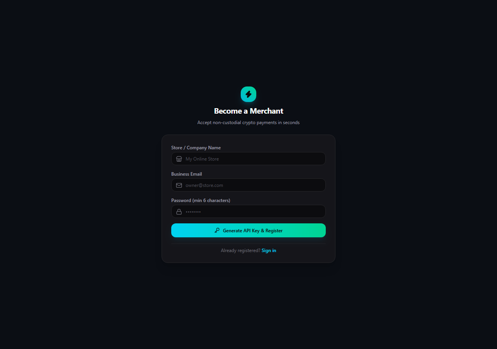
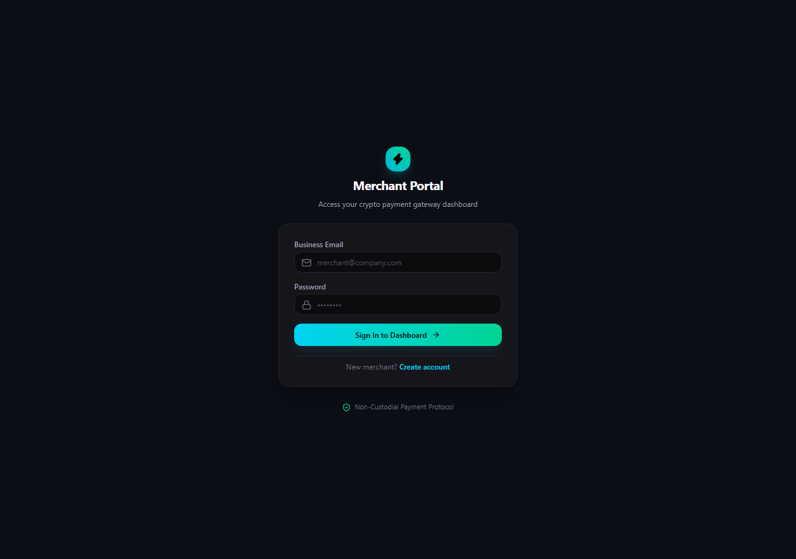
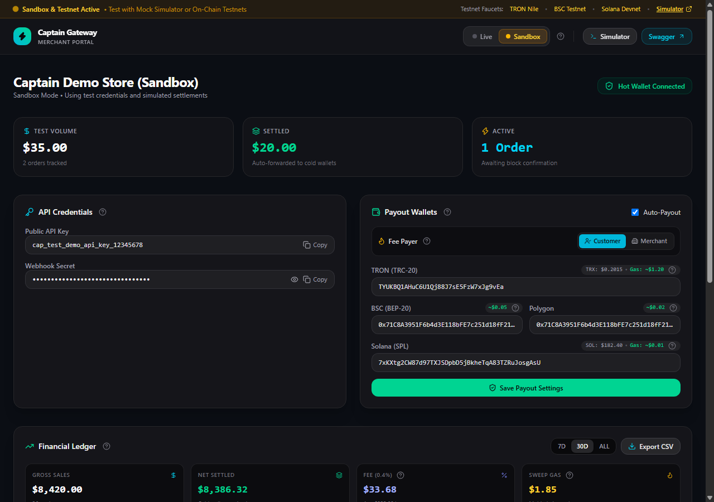
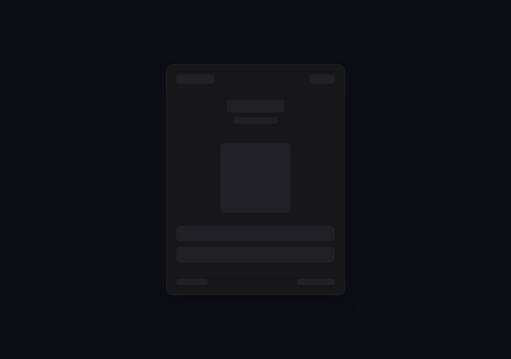
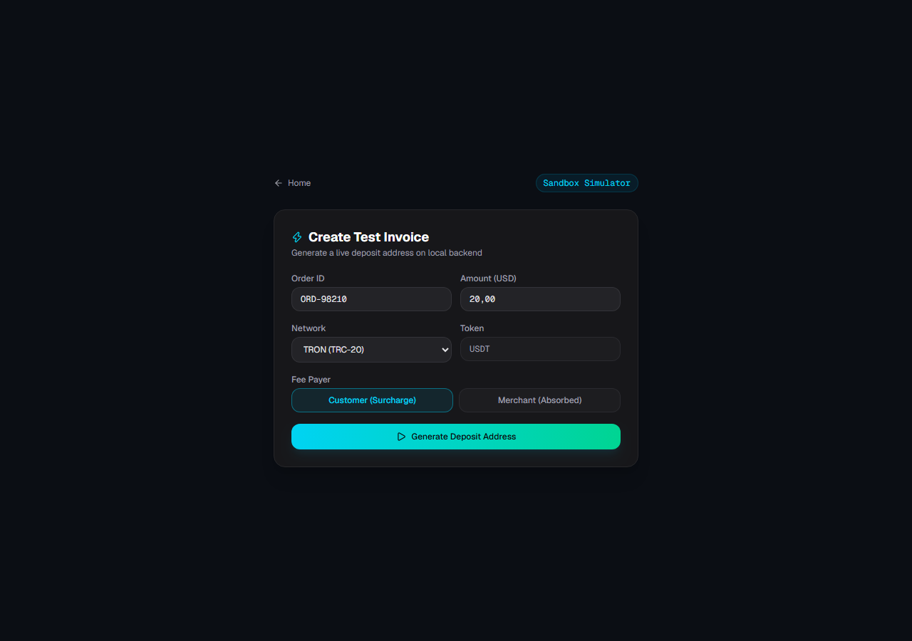
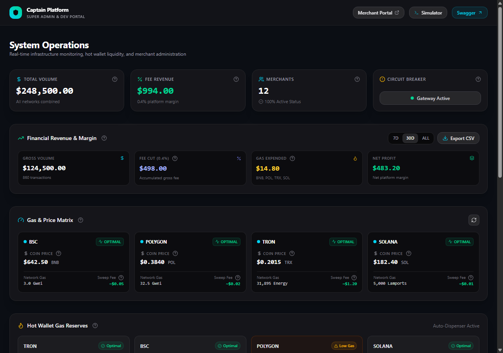

# Panduan Operasional & Dokumentasi Resmi Captain Crypto Payment Gateway

**Versi**: 1.2.0  
**Tanggal**: November 2026  
**Klasifikasi**: User Manual, Technical Specification & Integration Guide  
**Repositori**: [https://github.com/gonzhilaz/bpg.git](https://github.com/gonzhilaz/bpg.git)

---

## DAFTAR ISI

1. **Bab 1: Gambaran Umum & Spesifikasi Arsitektur**
   * 1.1 Prinsip Non-Custodial & Kedaulatan Dana
   * 1.2 Multi-Chain Network Matrix (BSC, Polygon, TRON, Solana)
   * 1.3 Siklus Tagihan 1 Invoice = 1 Dedicated Ephemeral Address
   * 1.4 Protokol Keamanan & API Key Hashing At-Rest

2. **Bab 2: Panduan Pengguna Merchant Portal**
   * 2.1 Pendaftaran Akun & Protokol *Reveal Once* API Key
   * 2.2 Autentikasi & Navigasi Dashboard
   * 2.3 Konfigurasi Cold Wallet Payout & Auto-Forwarding
   * 2.4 Pengaturan *Fee Payer* (Customer Surcharge vs. Merchant Absorbed)
   * 2.5 Pemantauan Laporan Keuangan (Financial Ledger) & Ekspor CSV
   * 2.6 Monitoring Riwayat Tagihan & Webhook Callback Logs

3. **Bab 3: Tutorial Integrasi Toko Online (Merchant Integration)**
   * 3.1 Pembuatan Tagihan via REST API (cURL, Node.js, PHP, Python)
   * 3.2 Menampilkan Checkout Widget ke Pelanggan
   * 3.3 Penanganan & Validasi Tanda Tangan Kriptografis Webhook (HMAC-SHA256)

4. **Bab 4: Panduan Pengujian Sandbox & Jaringan Testnet**
   * 4.1 Menggunakan Sandbox Simulator Bawaan
   * 4.2 Pengujian Transaksi On-Chain Menggunakan Faucet Testnet Resmi

5. **Bab 5: Panduan DevOps & Super Admin Portal**
   * 5.1 Dashboard Monitoring Operasional Platform
   * 5.2 Manajemen Cadangan Gas Hot Wallet & Alert Otomatis
   * 5.3 Prosedur Penyapuan Dana Manual (*Manual Sweeper*)
   * 5.4 Pemeliharaan Database (Pool Connection & Pruning Expired Records)
   * 5.5 Emergency Circuit Breaker (Prosedur Darurat Pembekuan Payout)
   * 5.6 Deployment Mandiri di Server VPS Menggunakan Docker Compose

---

## BAB 1: GAMBARAN UMUM & SPESIFIKASI ARSITEKTUR

### 1.1 Prinsip Non-Custodial & Kedaulatan Dana
Captain Crypto Payment Gateway dirancang untuk memecahkan kelemahan terbesar payment gateway sentralistik (seperti BitPay atau NOWPayments), yaitu risiko pembekuan dana sepihak (*fund freezing*) dan biaya perantara ganda.

Dengan arsitektur **Non-Custodial Instant Forwarding**, sistem Captain tidak pernah mengendapkan saldo merchant di akun perantara. Setiap pembayaran yang diverifikasi on-chain langsung disapu (*swept*) ke **Cold Wallet Pribadi Merchant** yang aman.

```
[Pembeli] ──────> [Alamat Tagihan Ephemeral] ──────> [Cold Wallet Merchant]
                         │
                         ▼
             [Indexer Node Memindai Event]
             [Webhook HMAC Dikirim ke Toko]
```

### 1.2 Multi-Chain Network Matrix
Sistem secara *native* mendukung 4 ekosistem blockchain utama dunia dengan biaya transaksi rendah dan finalitas blok instan:

| Blockchain | Standar Token | Satuan Biaya Gas | Kecepatan Konfirmasi | Estimasi Biaya Sweep |
| :--- | :--- | :--- | :--- | :--- |
| **BSC (BNB Smart Chain)** | BEP-20 (USDT / USDC) | Gwei (Native BNB) | ~3 Detik | ~$0.05 |
| **Polygon PoS** | ERC-20 (USDT / USDC) | Gwei (Native POL) | ~2 Detik | ~$0.02 |
| **TRON Network** | TRC-20 (USDT) | Energy & Bandwidth (TRX) | ~1 Detik | ~$1.20 |
| **Solana** | SPL Token (USDC / USDT) | Lamports (Native SOL) | ~400 Milidetik | ~$0.01 |

### 1.3 Siklus Tagihan 1 Invoice = 1 Dedicated Ephemeral Address
1. **Generasi Kunci Kriptografi**: Saat toko memanggil endpoint pembuatan invoice, backend Go membangkitkan pasangan kunci (*keypair*) baru secara dinamis menggunakan algoritma kriptografi standar industri (ECDSA secp256k1 untuk EVM/TRON dan Ed25519 untuk Solana).
2. **Enkripsi Kunci Privat**: Kunci privat dari alamat deposit langsung dienkripsi menggunakan sandi militer **AES-256-GCM** sebelum disimpan ke database.
3. **Masa Berlaku Tagihan**: Tagihan memiliki masa aktif 15–30 menit dengan hitung mundur presisi. Alamat yang kedaluwarsa tanpa pelunasan otomatis dinonaktifkan.

---

## BAB 2: PANDUAN PENGGUNA MERCHANT PORTAL

### 2.1 Pendaftaran Akun & Protokol Reveal Once API Key
Untuk menjadi merchant, kunjungi halaman registrasi di `/register`:



1. Masukkan **Nama Toko / Perusahaan**, **Business Email**, dan **Password** (minimal 6 karakter).
2. Klik tombol **Generate API Key & Register**.
3. **PENTING (Protokol Reveal Once)**: Sistem akan menampilkan kartu peringatan khusus yang memuat **Production API Key** dan **Webhook Secret**.
   * *Kunci ini hanya ditampilkan satu kali demi alasan keamanan tingkat tinggi.*
   * Segera klik tombol salin (*copy*) dan simpan di password manager atau file konfigurasi `.env` server toko Anda.
   * Di dalam database Captain, API Key disimpan dalam bentuk hash **SHA-256**, sehingga kunci asli tidak dapat dibaca oleh siapa pun jika database diretas.

### 2.2 Autentikasi & Navigasi Dashboard
Kunjungi halaman login di `/login`:



1. Masukkan email bisnis dan password yang telah didaftarkan.
2. Setelah berhasil masuk, Anda akan diarahkan ke halaman utama **Merchant Portal**.



### 2.3 Konfigurasi Cold Wallet Payout & Auto-Forwarding
Pada kartu **Payout Wallets**:
1. Masukkan alamat cold wallet penerima untuk masing-masing jaringan:
   * **TRON Address**: Alamat Base58 berawalan huruf `T` (misal dompet TronLink, Ledger, atau Binance).
   * **BSC Address**: Alamat 0x EVM (Trust Wallet, MetaMask, Safe).
   * **Polygon Address**: Alamat 0x EVM.
   * **Solana Address**: Alamat Base58 Solana (Phantom, Solflare).
2. Pastikan centang toggle **Auto-Payout** aktif agar dana otomatis diteruskan begitu transaksi terdeteksi.
3. Klik tombol **Save Payout Settings**.

### 2.4 Pengaturan Fee Payer (Customer Surcharge vs. Merchant Absorbed)
Di bagian atas kartu Payout Wallets, terdapat pemilih opsi **Fee Payer**:
* **Opsi Customer (Direkomendasikan)**: Biaya gas jaringan ditambahkan ke total invoice tagihan pembeli. Pembeli membayar produk + gas surcharge, merchant menerima nominal bersih 100%.
* **Opsi Merchant**: Pembeli membayar nominal pas harga produk, biaya gas penyapuan dipotong dari saldo yang masuk ke cold wallet merchant.

### 2.5 Pemantauan Laporan Keuangan (Financial Ledger) & Ekspor CSV
Kartu **Financial Ledger** menyediakan data audit pembukuan yang transparan:
* **Gross Sales**: Total akumulasi volume penjualan kotor.
* **Net Settled**: Total dana bersih yang telah sukses mendarat di Cold Wallet Anda.
* **Fee (0.4%)**: Akumulasi potongan biaya pemrosesan gateway.
* **Sweep Gas**: Estimasi biaya gas jaringan yang dikeluarkan untuk sweeping on-chain.
* **Filter Rentang Waktu**: Pilih `7D` (7 hari terakhir), `30D` (30 hari terakhir), atau `ALL` (sepanjang waktu).
* **Ekspor CSV**: Klik tombol **Export CSV** untuk mengunduh laporan pembukuan langsung ke komputer Anda dalam format spreadsheet.

### 2.6 Monitoring Riwayat Tagihan & Webhook Callback Logs
* **Tabel Recent Invoices**: Menampilkan nomor pesanan, nominal kripto, jaringan, deposit address, indikator Fee Payer, dan status terkini (`PENDING`, `DETECTED`, `PAID`, `UNDERPAID`, `EXPIRED`).
* **Tabel Settlement Transfers**: Menampilkan bukti tx hash on-chain dari penyapuan dana ke cold wallet Anda.
* **Kartu Webhook Delivery Logs**: Menampilkan riwayat pengiriman notifikasi HTTP POST ke server toko Anda lengkap dengan kode HTTP respons (200 OK) dan tanda tangan HMAC.

---

## BAB 3: TUTORIAL INTEGRASI TOKO ONLINE (MERCHANT INTEGRATION)

### 3.1 Pembuatan Tagihan via REST API
Server e-commerce toko Anda cukup memanggil endpoint berikut:

```bash
curl -X POST https://api.yourgateway.com/api/v1/invoices \
  -H "Content-Type: application/json" \
  -H "X-API-KEY: cap_live_9a41b2c8e104f..." \
  -d '{
    "order_id": "INV-2026-001",
    "amount": 50.00,
    "currency": "USD",
    "pay_currency": "USDT",
    "pay_network": "TRON",
    "fee_payer": "customer",
    "callback_url": "https://tokosaya.com/api/crypto-webhook"
  }'
```

#### Contoh Implementasi Node.js:
```javascript
const axios = require('axios');

async function createCryptoInvoice() {
  const response = await axios.post('https://api.yourgateway.com/api/v1/invoices', {
    order_id: 'ORD-88219',
    amount: 100.00,
    currency: 'USD',
    pay_currency: 'USDT',
    pay_network: 'BSC',
    fee_payer: 'customer',
    callback_url: 'https://tokosaya.com/api/crypto-webhook'
  }, {
    headers: { 'X-API-KEY': process.env.CAPTAIN_API_KEY }
  });

  const { id, deposit_address, pay_amount, pay_currency } = response.data.data;
  console.log(`Tagihan dibuat: Kirim ${pay_amount} ${pay_currency} ke ${deposit_address}`);
  return id;
}
```

#### Contoh Implementasi PHP:
```php
<?php
$apiKey = 'cap_live_9a41b2c8e104f...';
$payload = [
    'order_id'     => 'ORD-99120',
    'amount'       => 25.50,
    'currency'     => 'USD',
    'pay_currency' => 'USDT',
    'pay_network'  => 'POLYGON',
    'fee_payer'    => 'customer',
    'callback_url' => 'https://tokosaya.com/api/webhook'
];

$ch = curl_init('https://api.yourgateway.com/api/v1/invoices');
curl_setopt($ch, CURLOPT_RETURNTRANSFER, true);
curl_setopt($ch, CURLOPT_POST, true);
curl_setopt($ch, CURLOPT_POSTFIELDS, json_encode($payload));
curl_setopt($ch, CURLOPT_HTTPHEADER, [
    'Content-Type: application/json',
    'X-API-KEY: ' . $apiKey
]);

$result = json_decode(curl_exec($ch), true);
curl_close($ch);
?>
```

### 3.2 Menampilkan Checkout Widget ke Pelanggan
Setelah invoice dibuat, arahkan pembeli ke halaman checkout atau pasang iframe checkout:



Fitur Checkout Widget:
* **Dynamic QR Code**: Mendukung pemindaian dari kamera smartphone atau aplikasi Trust Wallet / Binance.
* **1-Click Copy**: Menyalin alamat deposit dan nominal presisi dalam 1 kali klik.
* **Rincian Transparan**: Menampilkan harga barang asli + surcharge gas jaringan (jika fee_payer adalah customer).
* **Hitung Mundur Kedaluwarsa**: Mencegah fluktuasi kurs yang merugikan merchant.
* **1-Click Web3 Pay**: Pembeli pengguna MetaMask atau Phantom dapat membayar langsung tanpa mengetik alamat manual.

### 3.3 Penanganan & Validasi Tanda Tangan Webhook (HMAC-SHA256)
Ketika pembayaran pembeli terkonfirmasi di blockchain, Captain mengirimkan callback HTTP POST ke `callback_url` toko Anda dengan header `X-Signature`.

#### Contoh Payload Webhook:
```json
{
  "event": "invoice.paid",
  "invoice_id": "4d374131-bcca-4749-8a5e-12c802131d1f",
  "order_id": "ORD-88219",
  "amount_paid": "100.0500",
  "pay_currency": "USDT",
  "pay_network": "BSC",
  "received_at": "2026-11-12T16:25:00Z"
}
```

#### Verifikasi Tanda Tangan di Node.js:
```javascript
const crypto = require('crypto');

function verifyWebhook(req, secretKey) {
  const signature = req.headers['x-signature'];
  const rawBody = JSON.stringify(req.body);
  const expectedSignature = 'sha256=' + crypto
    .createHmac('sha256', secretKey)
    .update(rawBody)
    .digest('hex');

  return signature === expectedSignature;
}
```

---

## BAB 4: PANDUAN PENGUJIAN SANDBOX & JARINGAN TESTNET

### 4.1 Menggunakan Sandbox Simulator Bawaan
Kunjungi `/sandbox` untuk menguji alur integrasi tanpa modal uang riil:



1. Isi form simulasi: Order ID, Nominal USD, Pilihan Network (TRON, BSC, Polygon, Solana), dan Fee Payer.
2. Klik tombol **Generate Deposit Address**.
3. Sistem akan memunculkan detail alamat uji coba dan tombol hijau **Simulate Payment**.
4. Begitu tombol simulasi diklik, backend Go akan memproses invoice seolah-olah terjadi transfer on-chain asli: status berubah menjadi `PAID`, rekonsiliasi auto-payout dibuat, dan webhook HMAC langsung ditembakkan ke URL callback toko Anda.

### 4.2 Pengujian Transaksi On-Chain Menggunakan Faucet Testnet Resmi
Jika Anda ingin menguji transaksi nyata dari dompet Web3 tanpa biaya:
1. Aktifkan jaringan Testnet pada wallet MetaMask atau Phantom Anda.
2. Klaim koin gratis melalui tautan Faucet resmi yang disediakan di banner atas Merchant Dashboard:
   * **TRON Nile Testnet**: [https://nileex.io/join/getJoinPage](https://nileex.io/join/getJoinPage)
   * **BSC Testnet Faucet**: [https://www.bnbchain.org/en/testnet-faucet](https://www.bnbchain.org/en/testnet-faucet)
   * **Solana Devnet Faucet**: [https://faucet.solana.com](https://faucet.solana.com)
3. Lakukan transfer koin testnet ke alamat deposit invoice. Watcher daemon Captain di background akan menangkap transaksi on-chain tersebut secara otomatis.

---

## BAB 5: PANDUAN DEVOPS & SUPER ADMIN PORTAL

### 5.1 Dashboard Monitoring Operasional Platform
Kunjungi Super Admin Portal di [https://bpg-admin.vercel.app](https://bpg-admin.vercel.app):



Portal ini diperuntukkan khusus bagi DevOps dan Pemilik Platform (*Platform Owner*) untuk mengawasi seluruh infrastruktur gateway secara real-time.

### 5.2 Manajemen Cadangan Gas Hot Wallet & Alert Otomatis
Pada kartu **Hot Wallet Gas Reserves**:
* Pantau saldo koin native operasional: **TRX & Energy Pool (TRON)**, **BNB (BSC)**, **POL (Polygon)**, dan **SOL (Solana)**.
* **Low Gas Alert**: Jika saldo native menipis hingga batas kritis, sistem akan memunculkan lencana kuning `LOW` sebagai peringatan untuk segera mengisi ulang (*top up*) gas agar penyapuan otomatis tidak terhambat.

### 5.3 Prosedur Penyapuan Dana Manual (Manual Sweeper)
Jika terjadi kondisi di mana saldo gas hot wallet sempat habis dan ada deposit pembayaran yang belum tersapu:
1. Isi ulang saldo gas native pada Master Hot Wallet yang bersangkutan.
2. Buka **Super Admin Portal** atau panggil endpoint `POST /api/v1/admin/sweeps/manual` dengan membawa `invoice_id`.
3. Mesin penyapu akan langsung mengeksekusi transfer on-chain memindahkan dana dari alamat deposit tagihan ke cold wallet merchant penerima.

### 5.4 Pemeliharaan Database (Database Engine & Pruning)
Pada kartu **Database Engine**:
* Pantau jumlah koneksi pool aktif (`open_connections`, `in_use`, `idle`).
* Pantau volume pertumbuhan baris tabel (`invoices`, `payouts`, `transactions`, `merchants`).
* **Pruning Rutin**: Klik tombol **Prune Expired** untuk membersihkan rekaman tagihan yang kedaluwarsa lebih dari 7 hari tanpa menghapus riwayat invoice yang sukses.

### 5.5 Emergency Circuit Breaker
Pada kartu **Platform Overview**:
* Terdapat sakelar darurat **Circuit Breaker Active**.
* Jika terjadi anomali pada blockchain (misal hard fork, reorg ekstrim, atau eksploitasi RPC node eksternal), admin dapat mengaktifkan Circuit Breaker dalam 1 klik.
* Saat aktif, seluruh eksekusi payout sweeping otomatis akan dibekukan sementara di memori hingga situasi jaringan dinyatakan aman.

### 5.6 Deployment Mandiri di Server VPS Menggunakan Docker Compose
Untuk mengoperasikan backend Go dan database PostgreSQL di server VPS privat:

```bash
# 1. Kloning repositori resmi
git clone https://github.com/gonzhilaz/bpg.git
cd bpg

# 2. Sesuaikan konfigurasi rahasia pada file .env
cp .env.example .env
nano .env

# 3. Jalankan container dengan Docker Compose
docker compose up -d --build

# 4. Pantau log operasional indexer blockchain
docker compose logs -f backend
```

---
*Dokumen manual ini dihasilkan secara otomatis dari spesifikasi arsitektur resmi Captain Crypto Payment Gateway v1.2.*
