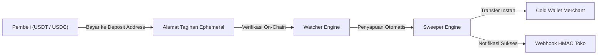

# Panduan Operasional & Dokumentasi Resmi 13C Crypto Payment Gateway

**Versi**: 2.3.0 (Enterprise Edition)  
**Tanggal**: November 2026  
**Klasifikasi**: User Manual & Operational Testing Guide  
**Repositori**: [https://github.com/gonzhilaz/bpg.git](https://github.com/gonzhilaz/bpg.git)

---

## DAFTAR ISI LENGKAP

1. **Bab 1: Gambaran Umum & Spesifikasi Arsitektur Non-Custodial**
   * 1.1 Prinsip Non-Custodial & Kedaulatan Dana
   * 1.2 Multi-Chain Network Matrix (BSC, Polygon, TRON, Solana)
   * 1.3 Siklus Tagihan 1 Invoice = 1 Dedicated Ephemeral Address
   * 1.4 Protokol Keamanan & API Key Hashing At-Rest

2. **Bab 2: Persiapan & Prasyarat Pengujian Sistem (Testing Setup Guide)**
   * 2.1 Prasyarat Lingkungan Perangkat Lunak (Software Prerequisites)
   * 2.2 Konfigurasi Berkas Lingkungan (.env, .env.local)
   * 2.3 Persiapan Dompet Kripto & Saldo Faucet Testnet
   * 2.4 Pendanaan Saldo Gas Hot Wallet Platform
   * 2.5 Prosedur Menjalankan Layanan (Backend, Dashboard & Demo Store)
   * 2.6 Panduan Pengujian Transaksi End-to-End (E2E Walkthrough)

3. **Bab 3: Panduan Pengguna Merchant Portal & Keterangan UI**
   * 3.1 Pendaftaran Akun & Protokol Reveal Once API Key
   * 3.2 Autentikasi, Multi-Route Sidebar & Navigasi
   * 3.3 Manajemen Tagihan Pelanggan (`/invoices`) & Filter Dropdown
   * 3.4 Konfigurasi Cold Wallet Payout & Gas Policy (`/wallets`)
   * 3.5 Pemantauan Laporan Keuangan (Financial Ledger) & Ekspor CSV
   * 3.6 Log Webhook & Tombol Test Ping / Manual Replay
   * 3.7 Manajemen Multi-Toko (Multi-Store per Merchant)

4. **Bab 4: Tutorial Integrasi Toko Online (Merchant Integration)**
   * 4.1 Pembuatan Tagihan via REST API (cURL, Node.js, PHP, Python)
   * 4.2 Menampilkan Checkout Widget ke Pelanggan
   * 4.3 Penanganan & Validasi Tanda Tangan Kriptografis Webhook (HMAC-SHA256)
   * 4.4 Plugin Resmi WooCommerce WordPress (`plugins/woocommerce-13c-gateway`)

5. **Bab 5: Pengujian Transaksi di Lingkungan Sandbox & Edge Cases**
   * 5.1 Menggunakan Sandbox Simulator Bawaan
   * 5.2 Pengujian Transaksi On-Chain Menggunakan Faucet Testnet Resmi
   * 5.3 Simulasi Edge Cases (Underpaid, Overpaid, Expired)

6. **Bab 6: Operasional DevOps & Konsol Super Admin**
   * 6.1 Dashboard Monitoring Operasional Platform
   * 6.2 Manajemen Cadangan Gas Hot Wallet & Alert Otomatis
   * 6.3 Prosedur Penyapuan Dana Manual (Manual Sweeper)
   * 6.4 Pemeliharaan Database (Pool Connection & Pruning Expired Records)
   * 6.5 Emergency Circuit Breaker (Prosedur Darurat Pembekuan Payout)
   * 6.6 Deployment Mandiri di Server VPS Menggunakan Docker Compose
   * 6.7 Resolusi Dinamis Endpoint (Zero Hardcoded Localhost & Cloud Ready)

7. **Bab 7: Manajemen Dinamis RPC, Keamanan 2FA & Next.js BFF Proxy**
   * 7.1 Manajemen Dinamis Multi-Chain RPC Node
   * 7.2 Autentikasi Ganda (2FA) Super Admin & Merchant Guard
   * 7.3 Enkoding & Proteksi Link API via Next.js BFF Reverse Proxy
   * 7.4 Tata Kelola Merchant Lengkap (Full CRUD Governance & Action Buttons)

8. **Bab 8: Sistem Escrow, Buku Besar Saldo Internal & Workflow Withdrawal**
   * 8.1 Arsitektur Hybrid: Non-Custodial Instant Forward vs. Escrow Balance
   * 8.2 Permintaan Penarikan Dana (Merchant Withdrawal)
   * 8.3 Tata Kelola Persetujuan Super Admin (Approve & Broadcast vs. Reject & Refund)

9. **Bab 9: Fitur Tingkat Tinggi & Optimisasi Industri**
   * 9.1 Real-Time Server-Sent Events (SSE) pada Checkout Widget
   * 9.2 Efisiensi Gas Biaya Sweeping via TRON Energy Rental
   * 9.3 Indeks Komposit Database & Automated Pruner Worker

10. **Bab 10: Panduan Pemecahan Masalah Komprehensif (Troubleshooting & FAQs)**
    * 10.1 Transaksi Kurang Bayar (Underpaid Invoice) & Ambang Batas Toleransi
    * 10.2 Tagihan Kedaluwarsa (Expired Invoice) Saat Dana Baru Dikirim
    * 10.3 RPC Node Timeout / Rate Limit (HTTP 429) & Failover Otomatis
    * 10.4 Kegagalan Pengiriman Webhook & Prosedur Manual Replay
    * 10.5 Saldo Gas Hot Wallet Menipis & Peringatan Ambang Batas
    * 10.6 Penanganan SQLite Lock (`database is locked`) & WAL Tuning

---

## BAB 1: GAMBARAN UMUM & SPESIFIKASI ARSITEKTUR

### 1.1 Prinsip Non-Custodial & Kedaulatan Dana
13C Crypto Payment Gateway dirancang untuk memecahkan kelemahan terbesar payment gateway sentralistik konvensional, yaitu risiko pembekuan dana sepihak (*fund freezing*) dan biaya perantara ganda.

Dengan arsitektur **Non-Custodial Instant Forwarding**, sistem 13C tidak pernah mengendapkan saldo merchant di akun perantara. Setiap pembayaran yang diverifikasi on-chain langsung disapu (*swept*) ke **Cold Wallet Pribadi Merchant** yang aman.

### 1.2 Multi-Chain Network Matrix
Sistem mendukung 4 jaringan blockchain terpopuler di dunia secara simultan:

| Blockchain | Standar Token | Satuan Gas | Kecepatan Finalitas | Karakteristik Utama |
| :--- | :--- | :--- | :--- | :--- |
| **BNB Smart Chain (BSC)** | BEP-20 (USDT/USDC) | BNB | 3 detik (3 blok) | Biaya gas sangat murah, ekosistem likuiditas tinggi |
| **Polygon (PoS)** | ERC-20 (USDT/USDC) | POL / MATIC | 2.1 detik (15 blok) | Kompatibel EVM, throughput tinggi |
| **TRON** | TRC-20 (USDT) | TRX / Energy | ~3 detik (19 blok) | Standar industri transfer USDT global |
| **Solana** | SPL Token (USDT/USDC) | SOL | 400 ms (Confirmed slot) | Kecepatan ultra-tinggi, finalitas instan |

### 1.3 Siklus Tagihan: 1 Invoice = 1 Dedicated Ephemeral Address
Untuk menjamin privasi dan kemudahan audit pembukuan:
* Setiap pembuatan invoice menghasilkan pasangan kunci unik baru (*fresh keypair*).
* Alamat deposit ini bertindak sebagai penampung sementara hanya untuk 1 transaksi spesifik tersebut.
* Tidak diperlukan Memo atau Tag tambahan dari pembeli, sehingga meminimalisasi salah transfer oleh pembeli awam.
* Kunci privat dienkripsi dengan **AES-256-GCM** sebelum disimpan ke database, dan dihapus dari memori aktif setelah penyapuan selesai.
