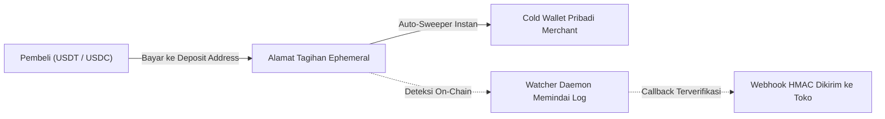

# Panduan Operasional & Dokumentasi Resmi 13C Crypto Payment Gateway

**Versi**: 2.2.0 (Enterprise Edition)  
**Tanggal**: November 2026  
**Klasifikasi**: User Manual, Technical Specification & Integration Guide  
**Repositori**: [https://github.com/gonzhilaz/bpg.git](https://github.com/gonzhilaz/bpg.git)

---

## DAFTAR ISI LENGKAP

1. **Bab 1: Gambaran Umum & Spesifikasi Arsitektur Non-Custodial**
   * 1.1 Prinsip Non-Custodial & Kedaulatan Dana
   * 1.2 Multi-Chain Network Matrix (BSC, Polygon, TRON, Solana)
   * 1.3 Siklus Tagihan 1 Invoice = 1 Dedicated Ephemeral Address
   * 1.4 Protokol Keamanan & API Key Hashing At-Rest

2. **Bab 2: Panduan Pengguna Merchant Portal & Keterangan UI**
   * 2.1 Pendaftaran Akun & Protokol *Reveal Once* API Key
   * 2.2 Autentikasi, Multi-Route Sidebar & Navigasi
   * 2.3 Manajemen Tagihan Pelanggan (`/invoices`) & Filter Dropdown
   * 2.4 Konfigurasi Cold Wallet Payout & Gas Policy (`/wallets`)
   * 2.5 Pemantauan Laporan Keuangan (Financial Ledger) & Ekspor CSV
   * 2.6 Log Webhook & Tombol Test Ping / Manual Replay
   * 2.7 Manajemen Multi-Toko (*Multi-Store per Merchant*)

3. **Bab 3: Tutorial Integrasi Toko Online (Merchant Integration)**
   * 3.1 Pembuatan Tagihan via REST API (cURL, Node.js, PHP, Python)
   * 3.2 Menampilkan Checkout Widget ke Pelanggan
   * 3.3 Penanganan & Validasi Tanda Tangan Kriptografis Webhook (HMAC-SHA256)
   * 3.4 Plugin Resmi WooCommerce WordPress (`plugins/woocommerce-13c-gateway`)

4. **Bab 4: Panduan Pengujian Sandbox & Jaringan Testnet**
   * 4.1 Menggunakan Sandbox Simulator Bawaan
   * 4.2 Pengujian Transaksi On-Chain Menggunakan Faucet Testnet Resmi
   * 4.3 Simulasi Edge Cases (Underpaid, Overpaid, Expired)

5. **Bab 5: Panduan DevOps & Super Admin Portal**
   * 5.1 Dashboard Monitoring Operasional Platform
   * 5.2 Manajemen Cadangan Gas Hot Wallet & Alert Otomatis
   * 5.3 Prosedur Penyapuan Dana Manual (*Manual Sweeper*)
   * 5.4 Pemeliharaan Database (Pool Connection & Pruning Expired Records)
   * 5.5 Emergency Circuit Breaker (Prosedur Darurat Pembekuan Payout)
   * 5.6 Deployment Mandiri di Server VPS Menggunakan Docker Compose
   * 5.7 Resolusi Dinamis Endpoint (Zero Hardcoded Localhost & Cloud Ready)

6. **Bab 6: Manajemen Dinamis RPC, Keamanan 2FA & Next.js BFF Proxy**
   * 6.1 Manajemen Dinamis Multi-Chain RPC Node
   * 6.2 Autentikasi Ganda (2FA) Super Admin & Merchant Guard
   * 6.3 Enkoding & Proteksi Link API via Next.js BFF Reverse Proxy
   * 6.4 Tata Kelola Merchant Lengkap (Full CRUD Governance & Action Buttons)

7. **Bab 7: Sistem Escrow, Buku Besar Saldo Internal & Workflow Withdrawal**
   * 7.1 Arsitektur Hybrid: Non-Custodial Instant Forward vs. Escrow Balance
   * 7.2 Permintaan Penarikan Dana (*Merchant Withdrawal*)
   * 7.3 Tata Kelola Persetujuan Super Admin (*Approve & Broadcast vs. Reject & Refund*)

8. **Bab 8: Model Kepemilikan Mandiri (White-Label Sovereignty & Jual Putus)**
   * 8.1 Jaminan Nol Telemetri (*Zero-Phone-Home Guarantee*)
   * 8.2 Kedaulatan Master Secret & Kunci Privat (*Self-Sovereignty*)
   * 8.3 Kemudahan White-Labeling & Rebranding

9. **Bab 9: Fitur Tingkat Tinggi & Optimisasi Industri**
   * 9.1 Real-Time Server-Sent Events (SSE) pada Checkout Widget
   * 9.2 Efisiensi Gas Biaya Sweeping via TRON Energy Rental
   * 9.3 Indeks Komposit Database & Automated Pruner Worker

10. **Bab 10: Integrasi Hybrid dengan Payment Gateway Fiat (Studi Kasus Kaguh.id)**
    * 10.1 Arsitektur Unified Gateway: Fiat + Crypto Channel
    * 10.2 Pemetaan Produk (`product_code`) pada `POST /v2/transactions`
    * 10.3 Konversi Kurs Otomatis (IDR $\leftrightarrow$ USDT) via Rate Service
    * 10.4 Webhook Bridge Callback (13C Engine $\to$ Kaguh API $\to$ Toko Merchant)
    * 10.5 Tampilan Terpadu di Kaguh Business Portal (`business.kaguh.id`)

11. **Bab 11: Panduan Pemecahan Masalah Komprehensif (Troubleshooting & FAQs)**
    * 11.1 Transaksi Kurang Bayar (*Underpaid Invoice*) & Ambang Batas Toleransi
    * 11.2 Tagihan Kedaluwarsa (*Expired Invoice*) Saat Dana Baru Dikirim
    * 11.3 RPC Node Timeout / Rate Limit (HTTP 429) & Failover Otomatis
    * 11.4 Kegagalan Pengiriman Webhook & Prosedur Manual Replay
    * 11.5 Saldo Gas Hot Wallet Menipis & Peringatan Ambang Batas
    * 11.6 Penanganan SQLite Lock (`database is locked`) & WAL Tuning

12. **Bab 12: Panduan Proteksi Kode Sumber & Kompilasi Biner Aman**
    * 12.1 Strip Debugging Symbols & DWARF Information (`-ldflags="-s -w"`)
    * 12.2 Obfuscasi Tingkat Lanjut Menggunakan Garble (`-literals -tiny`)
    * 12.3 Distribusi Berbasis Docker Distroless / Scratch (*Zero Source Code Delivery*)
    * 12.4 Proteksi Frontend Next.js (Disable Source Maps & Standalone Output)

---

## BAB 1: GAMBARAN UMUM & SPESIFIKASI ARSITEKTUR

### 1.1 Prinsip Non-Custodial & Kedaulatan Dana
13C Crypto Payment Gateway dirancang untuk memecahkan kelemahan terbesar payment gateway sentralistik konvensional, yaitu risiko pembekuan dana sepihak (*fund freezing*) dan biaya perantara ganda.

Dengan arsitektur **Non-Custodial Instant Forwarding**, sistem 13C tidak pernah mengendapkan saldo merchant di akun perantara. Setiap pembayaran yang diverifikasi on-chain langsung disapu (*swept*) ke **Cold Wallet Pribadi Merchant** yang aman.

### 1.2 Multi-Chain Network Matrix
Sistem secara *native* mendukung 4 ekosistem blockchain utama dunia dengan biaya transaksi rendah dan finalitas blok instan:

| Blockchain | Standar Token | Satuan Biaya Gas | Kecepatan Konfirmasi | Estimasi Biaya Sweep |
| :--- | :--- | :--- | :--- | :--- |
| **BSC (BNB Smart Chain)** | BEP-20 (USDT / USDC) | Gwei (Native BNB) | ~3 Detik | ~$0.05 |
| **Polygon PoS** | ERC-20 (USDT / USDC) | Gwei (Native POL) | ~2 Detik | ~$0.02 |
| **TRON Network** | TRC-20 (USDT) | Energy & Bandwidth (TRX) | ~1 Detik | ~$1.20 |
| **Solana** | SPL Token (USDC / USDT) | Lamports (Native SOL) | ~400 Milidetik | ~$0.01 |

### 1.3 Siklus Tagihan 1 Invoice = 1 Dedicated Ephemeral Address
1. **Generasi Kunci Kriptografi**: Saat toko memanggil endpoint pembuatan invoice, backend Go membangkitkan pasangan kunci (*keypair*) baru secara dinamis menggunakan algoritma kriptografi standar industri (ECDSA secp256k1 untuk EVM/TRON dan Ed25519 untuk Solana).
2. **Enkripsi Kunci Privat**: Kunci privat dari alamat deposit langsung dienkripsi menggunakan sandi militer **AES-256-GCM** sebelum disimpan ke database.
3. **Masa Berlaku Tagihan**: Tagihan memiliki masa aktif 15–30 menit dengan hitung mundur presisi. Alamat yang kedaluwarsa tanpa pelunasan otomatis dinonaktifkan.
