---

## BAB 6: MANAJEMEN NODE RPC & KONSOL SUPER ADMIN

### 6.1 Manajemen Node RPC Dinamis (Multi-Chain Failover)
Infrastruktur 13C Payment Gateway tidak bergantung pada satu penyedia RPC blockchain. Super Admin dapat mendaftarkan beberapa endpoint RPC untuk masing-masing jaringan (BSC, Polygon, TRON, Solana) langsung dari antarmuka Web Console:
* **Circuit Breaker per RPC:** Sistem secara otomatis mendeteksi latensi tinggi (>3.000 ms) atau tingkat kegagalan (*HTTP 429 Too Many Requests / 5xx*) dan mengalihkan panggilan ke node RPC sekunder secara transparan.
* **Health Check Otomatis:** Daemon latar belakang mengirimkan ping JSON-RPC berkala (`eth_blockNumber`, `getLatestBlock`, dsb.) setiap 30 detik untuk memastikan node dalam kondisi sinkron.

### 6.2 Otentikasi Super Admin & Keamanan 2FA (TOTP)
Akses ke Super Admin Console dilindungi oleh lapisan keamanan berlapis:
1. **Otentikasi Kredensial & TOTP:** Menggunakan kombinasi email/password terenkripsi `bcrypt` dan verifikasi One-Time Password berbasis RFC 6238 (Google Authenticator / Authy).
2. **Next.js BFF Reverse Proxy (Anti-Inspection):**
   * Seluruh panggilan API dari browser admin dialihkan melalui Next.js Backend-for-Frontend (BFF) di `/api/admin/*`.
   * Endpoint backend internal Go (`http://localhost:8080`) tidak pernah diekspos langsung ke publik.
   * Header otorisasi JWT disematkan di sisi server (*Server-Side Route Handler*) sehingga token tidak dapat diinspeksi atau dicuri melalui DevTools browser.

### 6.3 Manajemen Merchant & Toko (Full CRUD)
Super Admin memiliki kendali penuh terhadap operasional seluruh ekosistem:
* **Aktivasi & Penonaktifan:** Menonaktifkan merchant nakal secara instan tanpa mengganggu merchant lain.
* **Override Biaya Layanan:** Mengatur persentase potongan platform fee (misal 0.5% atau 1%) per merchant.
* **Monitoring Volume Transaksi:** Grafik real-time agregat volume transaksi, rasio keberhasilan invoice, dan cadangan gas native platform.

---

## BAB 7: ARSITEKTUR ESCROW VS INSTANT FORWARD & PENARIKAN

### 7.1 Perbandingan Mode Settlement

```mermaid
flowchart TD
    subgraph MODE_A["Mode 1: Instant Direct Sweep"]
        A1["Pelanggan Bayar ke Ephemeral Address"] --> A2["Watcher Deteksi Konfirmasi On-Chain"]
        A2 --> A3["Auto-Sweeper Kirim Langsung ke Cold Wallet Merchant"]
        A3 --> A4["Zero Custody - Dana Langsung Milik Merchant"]
    end

    subgraph MODE_B["Mode 2: Escrow Ledger Settlement"]
        B1["Pelanggan Bayar ke Ephemeral Address"] --> B2["Sweeper Mengumpulkan Dana ke Hot/Warm Pool"]
        B2 --> B3["Saldo Dicatat di Internal Merchant Ledger"]
        B3 --> B4["Merchant Mengajukan Penarikan (Payout Request)"]
        B4 --> B5["Super Admin Menyetujui & Eksekusi Batch Transfer"]
    end
```

### 7.2 Alur Pengajuan & Persetujuan Penarikan (Escrow Payout)
1. **Pengajuan oleh Merchant:**
   * Merchant membuka menu **Payout / Withdraw** di portal.
   * Memilih mata uang (USDT/USDC) dan jaringan tujuan.
   * Memasukkan nominal penarikan (minimal \$10).
   * Status mutasi tercatat sebagai `PENDING_APPROVAL`.
2. **Review & Persetujuan Super Admin:**
   * Admin memeriksa keabsahan transaksi pada tabel **Settlement Queue**.
   * Menekan tombol **Approve**: Sistem menandatangani transaksi on-chain dari Warm Pool ke dompet merchant dan mencatat hash transaksi.
   * Menekan tombol **Reject**: Sistem membatalkan penarikan dan mengembalikan saldo ke buku besar merchant disertai catatan alasan penolakan.

---

## BAB 8: WHITE-LABEL SOVEREIGNTY (KEDAULATAN KEPEMILIKAN)

### 8.1 Jaminan Jual Putus (Zero-Phone-Home)
Sistem 13C Payment Gateway dirancang sebagai platform mandiri (*Perpetual Sovereign Architecture*):
* **Tanpa Lisensi Server Vendor:** Tidak ada panggilan berkala (*heartbeat / phone home*) ke server vendor.
* **Tanpa Token Aktivasi / DRM:** Sistem berjalan 100% mandiri pada server Anda tanpa ketergantungan koneksi eksternal apa pun selain node RPC blockchain.
* **Privasi Total:** Data transaksi, daftar pelanggan, kunci privat dompet, dan omzet bisnis tersimpan secara eksklusif di server privat Anda.

### 8.2 Tata Kelola Master Key Enkripsi
* Kunci enkripsi database (`MASTER_SECRET_KEY`) dikonfigurasi melalui berkas `.env` server Anda.
* Kunci privat alamat deposit sementara dienkripsi secara simetris menggunakan algoritma **AES-256-GCM** sebelum disimpan di database.
* Anda memegang kontrol mutlak atas cadangan kunci, frase pemulihan Hot Wallet, dan master secret key tanpa campur tangan pihak ketiga.

---

## BAB 9: FITUR LANJUTAN & OPTIMASI TEKNIS

### 9.1 Server-Sent Events (SSE) pada Checkout Widget
Halaman checkout widget (`/checkout?invoice=...`) dilengkapi dengan koneksi **Server-Sent Events (SSE)** real-time:
* Pelanggan tidak perlu me-refresh halaman saat menunggu konfirmasi blockchain.
* Begitu transaksi terdeteksi di mempool atau kedalaman blok terpenuhi, widget secara instan berubah status menjadi `DETECTED` kemudian `PAID` dengan animasi sukses interaktif.
* Dilengkapi *fallback polling* otomatis jika browser pelanggan memblokir koneksi SSE.

### 9.2 Optimasi Biaya Gas TRON (Energy Rental)
Transaksi transfer token TRC-20 pada jaringan TRON membutuhkan energi besar (~65.000 Energy per transfer) yang jika dibayar dengan TRX mentah (*burn TRX*) dapat menghabiskan 13 - 27 TRX per transaksi.
* **Dukungan Delegasi Energi:** 13C mendukung integrasi dengan penyedia sewa energi TRON (Feee.io / JustLend).
* **Penghematan Signifikan:** Biaya transaksi TRC-20 berkurang hingga 70%–85%, memaksimalkan margin keuntungan platform dan merchant.

### 9.3 Indeks Majemuk Basis Data & Pemangkas Otomatis (Pruner)
* **Kueri Skala Jutaan Record:** Tabel `invoices` dan `webhook_logs` diindeks menggunakan *B-Tree Composite Indexes* (`(merchant_id, status, created_at)` dan `(pay_network, address)`).
* **Automated Data Pruner:** Daemon pembersih membersihkan log webhook berhasil yang berumur lebih dari 30 hari secara berkala pada jam non-sibuk (*off-peak hours*) untuk menjaga ukuran file database tetap ramping dan responsif.
