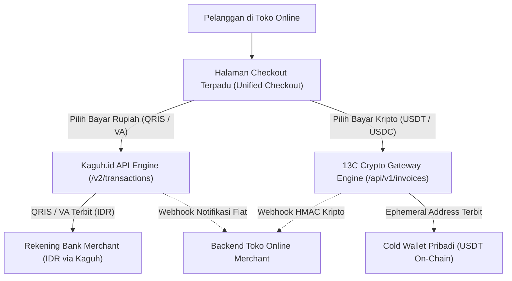
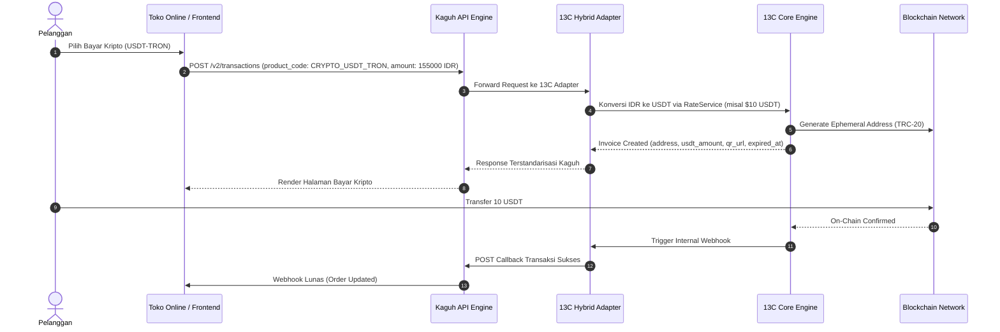

---

## BAB 10: INTEGRASI HYBRID FIAT GATEWAY (KAGUH.ID)

### 10.1 Konsep Solusi Hybrid (Fiat + Kripto)
Banyak merchant digital memerlukan penerimaan pembayaran dua arah: mata uang fiat lokal Indonesia (Rupiah/IDR melalui QRIS, Virtual Account BCA/BRI/Mandiri, E-Wallet) dan mata uang kripto global (USDT & USDC).

Platform 13C Crypto Payment Gateway dirancang untuk dapat digabungkan secara mulus dengan penyedia Fiat Payment Gateway, seperti **Kaguh.id** (`https://docs.kaguh.id/` & `https://business.kaguh.id/`).



### 10.2 Arsitektur Alur Transaksi Kaguh.id (`/v2/transactions`)
Sesuai dengan spesifikasi OpenAPI v2.0 Kaguh.id, setiap transaksi fiat dibuat melalui endpoint:
`POST https://api.kaguh.id/v2/transactions`

#### Parameter Transaksi Kaguh:
* `partner_order_id`: ID unik transaksi dari sistem merchant.
* `product_code`: Kode kanal pembayaran (misal `QRIS`, `VA_BCA`, `VA_MANDIRI`, `OVO`, `DANA`).
* `amount`: Nominal tagihan dalam mata uang Rupiah (IDR).
* `customer_name`: Nama pembeli.
* `customer_email`: Alamat email pembeli.
* `callback_url`: URL webhook untuk menerima update status transaksi.

### 10.3 Pemetaan Kanal Kripto 13C pada Ekosistem Kaguh
Jika Kaguh bertindak sebagai agregator pembayaran utama (*Single Entry-Point*), kanal 13C didaftarkan sebagai saluran pembayaran digital dengan `product_code` khusus:
* `CRYPTO_USDT_TRON` : Tether pada jaringan TRON (TRC-20)
* `CRYPTO_USDT_BSC`  : Tether pada jaringan Binance Smart Chain (BEP-20)
* `CRYPTO_USDT_POL`  : Tether pada jaringan Polygon (ERC-20)
* `CRYPTO_USDT_SOL`  : Tether pada jaringan Solana (SPL)

#### Alur Eksekusi Bridge API:


### 10.4 Layanan Konversi Kurs Otomatis (Rate Service)
Untuk menghubungkan nilai Rupiah (IDR) pada tagihan Kaguh dengan nominal token kripto (USDT):
1. **Ticker Otomatis:** Modul `RateService` pada 13C melakukan agregasi kurs real-time dari bursa terdaftar (Indodax, Tokocrypto, atau Binance P2P IDR).
2. **Perlindungan Volatilitas (Price Lock Period):** Nilai kurs dikunci (*locked*) selama durasi aktif invoice (misal 15 menit). Jika nilai $1 \text{ USDT} = \text{Rp } 15.800$, maka tagihan Rp 158.000 akan menghasilkan nilai pembayaran tepat $10,000000 \text{ USDT}$.
3. **Penyelarasan Webhook (Webhook Harmonization):**
   Payload webhook dari 13C diterjemahkan ke format payload standar Kaguh:
   ```json
   {
     "status": "SUCCESS",
     "partner_order_id": "ORD-20261121-001",
     "transaction_id": "TX-13C-98234710",
     "product_code": "CRYPTO_USDT_TRON",
     "amount": 158000,
     "crypto_amount": "10.000000",
     "crypto_currency": "USDT",
     "tx_hash": "a8f3b2c1e4d56789...",
     "paid_at": "2026-11-21T18:45:00Z"
   }
   ```
