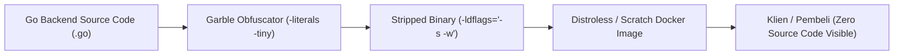

---

## BAB 11: PANDUAN PEMECAHAN MASALAH (TROUBLESHOOTING & FAQ)

### 11.1 Kasus Pembayaran Kurang (*Underpaid Invoices*)
* **Masalah:** Pelanggan mengirimkan nominal lebih sedikit dari tagihan karena terpotong biaya transfer dari bursa (misal transfer $10, namun bursa memotong fee $1 sehingga hanya sampai $9).
* **Solusi Otomatis:**
  * 13C menyediakan fitur `underpaid_threshold_percentage` (default 1% - 2%).
  * Jika selisih berada dalam ambang batas toleransi, status invoice tetap otomatis diubah menjadi `PAID` dan webhook dikirimkan.
  * Jika selisih melebihi toleransi, status menjadi `UNDERPAID`. Widget menampilkan sisa kekurangan dana yang wajib disetor pelanggan sebelum kedaluwarsa.

### 11.2 Kasus Pembayaran Kedaluwarsa (*Expired / Late Payment*)
* **Masalah:** Pelanggan baru mentransfer setelah batas waktu 15 menit berakhir, atau transaksi tertahan lama di mempool blockchain.
* **Penanganan:**
  * Alamat deposit tetap dipantau oleh *Late Sweeper Worker* hingga 24 jam.
  * Jika dana mendarat setelah status menjadi `EXPIRED`, dana tidak akan hilang. Sistem otomatis melakukan sweeping ke Cold Wallet merchant dan menandai invoice sebagai `SETTLED_AFTER_EXPIRY` pada buku besar keuangan.

### 11.3 Gangguan Koneksi Node RPC (*RPC Drop & Timeout*)
* **Gejala:** Watcher terlambat mendeteksi konfirmasi transaksi atau muncul log `HTTP 429 Too Many Requests`.
* **Langkah Pemulihan:**
  1. Masuk ke **Super Admin Console -> RPC Management**.
  2. Tambahkan endpoint RPC cadangan (misal dari Ankr, Alchemy, atau QuickNode).
  3. Aktifkan saklar **Auto-Failover** agar sistem berpindah node secara otomatis saat node utama mengalami *rate-limit*.

### 11.4 Peringatan Saldo Cadangan Gas Menipis (*Low Hot Wallet Gas*)
* **Gejala:** Dashboard Super Admin menampilkan badge merah *Warning: Gas Low*, dan auto-sweeping tertunda.
* **Langkah Pemulihan:**
  1. Periksa saldo dompet Hot Wallet pada jaringan yang bermasalah (BNB, POL, TRX, atau SOL).
  2. Lakukan deposit koin native secukupnya (misal 0.05 BNB, 10 MATIC, 50 TRX, atau 0.1 SOL) ke alamat Hot Wallet yang tertera di konsol admin.
  3. Tekan tombol **Trigger Manual Sweeper** untuk mengeksekusi antrean transaksi yang tertahan.

### 11.5 Optimasi SQLite WAL Mode (*Database Locked Fix*)
* **Gejala:** Pesan error `database is locked (5)` pada log backend Go saat volume transaksi simultan tinggi.
* **Solusi Arsitektural:**
  * Pastikan koneksi database menggunakan flag **WAL (Write-Ahead Logging)** dan `busy_timeout=5000`:
    ```go
    db, err := sql.Open("sqlite3", "file:data/gateway.db?_journal_mode=WAL&_busy_timeout=5000&_synchronous=NORMAL")
    ```
  * Mode WAL memungkinkan operasi pembacaan (*read*) berjalan bersamaan tanpa pernah terblokir oleh operasi penulisan (*write*).

---

## BAB 12: PROTEKSI DAN OBFUSKASI KODE SUMBER (JUAL PUTUS)

Saat menjual aplikasi dengan skema jual putus (*outright sale*), Anda mungkin ingin mendistribusikan aplikasi tanpa menyertakan kode sumber mentah (*un-obfuscated plain code*) agar hak cipta dan logika internal sistem tetap terlindungi dari penyalinan tidak sah.



### 12.1 Kompilasi Biner Terproteksi (Stripping Symbols)
Gunakan flag `-ldflags="-s -w"` saat melakukan build Go untuk menghapus seluruh tabel simbol debug dan informasi penelusuran (*DWARF debugging information*):
```bash
go build -ldflags="-s -w" -trimpath -o build/gateway_server cmd/server/main.go
```
* Efek: Binary menjadi 40% lebih kecil dan program decompiler (IDA Pro, Ghidra) tidak dapat menampilkan nama fungsi asli.

### 12.2 Obfuskasi Tingkat Lanjut Menggunakan Garble
Untuk perlindungan maksimal, gunakan tool `garble` (obfuskator resmi komunitas Go):
```bash
# Instalasi Garble
go install mvdan.cc/garble@latest

# Kompilasi dengan enkripsi literal string dan obfuskasi token
garble -literals -tiny build -ldflags="-s -w" -trimpath -o build/gateway_secure cmd/server/main.go
```
* **Enkripsi Literal (`-literals`):** Seluruh string teks (seperti SQL query, nama tabel, rute endpoint) dienkripsi secara acak di dalam memori biner sehingga tidak dapat dibaca menggunakan perintah `strings`.
* **Pengacakan Nama (`-tiny`):** Nama paket, fungsi, struct, dan variabel diubah menjadi karakter acak non-semantik (misal `f8g9a()`).

### 12.3 Distribusi Menggunakan Docker Distroless / Scratch
Untuk distribusi profesional ke klien tanpa mengekspos sistem file server:
1. Gunakan *Multi-Stage Dockerfile* dengan basis image `gcr.io/distroless/static-debian12` atau `scratch`.
2. Di dalam kontainer akhir, hanya ada 1 file biner yang telah diobfuskasi tanpa ada shell (`sh`/`bash`), tanpa package manager, dan tanpa compiler.
3. Klien hanya menerima Docker image yang siap dijalankan melalui `docker compose up -d` dengan kinerja tinggi dan tingkat keamanan tingkat enterprise.
